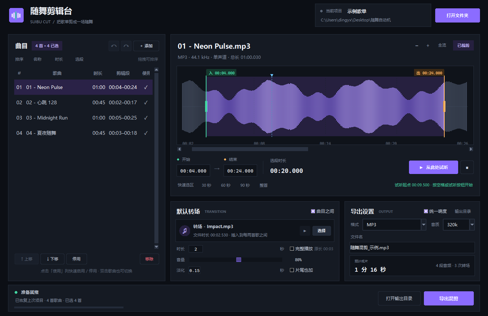

# 随舞剪辑台 · SUIBU CUT

**v1.1.0** · 把一整个歌单，自动拼剪成一场随舞。

随舞剪辑台是一个面向随舞 / 随机舞蹈活动的桌面音频剪辑工具：打开歌单文件夹，按顺序挑选每首歌要剪进去的片段，设置一个默认转场音效，软件就会自动完成裁剪、拼接和导出。



## 下载

- **便携版（推荐给使用者）**：到 [Releases](https://github.com/DcSyaA/suibu-cut/releases/latest) 下载最新的
  `suibu-cut_v1.1.0_portable.zip`（显示名为「随舞剪辑台 v1.1.0 便携版」），解压后双击 `随舞剪辑台.exe` 即可。
  压缩包自带 FFmpeg 与精简 Python 运行时，无需安装任何依赖，解压后约 90 MB。
- **源码（给开发者）**：克隆本仓库后从源码运行，见下文「[开发者信息](#开发者信息)」。
  源码仓库不包含 `bin\ffmpeg.exe` 和 `runtime\`，需要自行准备，见 [`bin/README.md`](bin/README.md)。

## 快速开始

1. 解压整个文件夹（不要只复制 exe）。
2. 双击 **`随舞剪辑台.exe`**。
3. 点击右上角 **打开文件夹**，选择存放歌曲的文件夹。
4. 在左侧勾选要使用的歌曲，并拖拽或使用上移 / 下移调整顺序。
5. 选中歌曲，在波形上拖动绿色 / 橙色把手，选择要剪进混剪的时间段。
6. 在“默认转场”中选择一个音频文件，设置时长、音量与淡化。不需要转场时，取消勾选“曲目之间”。
7. 在“导出设置”中选择格式和文件名，点击 **导出混剪**。

导出文件默认保存在歌单文件夹下的 `输出` 目录。项目会自动保存为歌单文件夹中的 `随舞项目.json`，下次打开同一个文件夹会恢复歌单顺序、选段和转场设置。

> 系统要求：Windows 10 / 11（64 位）。便携版无需安装 Python 或 FFmpeg。

## 功能

### 歌单与项目

- 打开任意文件夹作为项目，自动扫描支持的音乐文件并按文件名自然排序。
- 支持 MP3、WAV、FLAC、M4A、AAC、OGG、OPUS、WMA、AIFF、APE 等常见格式。
- 按文件名、歌曲时长或选段时长排序，点击排序按钮可在升序 / 降序之间切换。
- 拖拽歌曲、上移 / 下移调整播放顺序。
- 点击“使用”列、双击歌曲或点击“停用”，可临时把歌曲排除在混剪之外。
- 从项目移除歌曲不会删除源文件；重新打开项目时也不会被自动加回来。
- 点击“添加”可把项目文件夹之外的音乐加入歌单。
- 按 `F5` 重新扫描文件夹，新增的歌曲会追加到列表末尾。
- 支持撤销 / 重做最近 100 步编辑（选段、排序、启用、转场、导出设置等）。

### 精确选段

- 波形由 FFmpeg 实时分析生成，选区内高亮显示。
- 拖动绿色把手修改开始时间，拖动橙色把手修改结束时间，拖动选区可整体平移。
- 在选区外单击可重新定位；也可以直接输入 `01:23.500`、`83.5` 或 `1m23s`。
- 快速选区：30 秒、60 秒、90 秒、整首。
- 波形支持缩放和横向滚动：`−` / `+` / `全览`，或 `Ctrl + 滚轮` 缩放、滚轮平移、底部滚动条拖动。
- 支持自定义试听起点：点击底部时间标尺、`Shift + 点击` 波形，或在波形上右键选择“从此处试听”；再按 `Space` 或试听按钮即可从该位置播放到选段结尾。
- 支持试听选段，播放时波形上会显示游标。
- 歌曲边缘自动加入 60ms 淡化，避免拼接时出现爆音。

### 默认转场

- 选择一个音频文件作为全局默认转场；如果转场文件就在项目文件夹中，会自动从歌曲列表移出。
- 可设置转场插入位置：每两首歌之间、片尾也加。
- 可设置转场长度，或勾选“完整播放”。
- 可设置转场音量（0–150%）和首尾淡化时间。
- 支持单独试听转场。

### 导出

- 输出格式：MP3、WAV、M4A (AAC)、FLAC。
- MP3 默认 320kbps，可选 256kbps / 192kbps。
- 可勾选“统一响度”，使用 EBU R128 单遍 `loudnorm` 统一到约 -14 LUFS，减少不同歌曲之间的响度差。
- 所有片段统一为 48kHz / 立体声，按歌单顺序拼接。
- 导出前会检查缺失文件、未读取完成的歌曲和无效选段。
- 同名文件自动使用 `(2)`、`(3)` 等后缀，不会覆盖已有成品。
- 导出过程显示进度，可随时取消。
- 完成后可直接打开输出目录。

## 快捷键

| 快捷键 | 功能 |
| --- | --- |
| `Ctrl + Z` | 撤销 |
| `Ctrl + Y` / `Ctrl + Shift + Z` | 重做 |
| `Ctrl + O` | 打开歌单文件夹 |
| `Ctrl + S` | 立即保存项目 |
| `Ctrl + E` | 导出混剪 |
| `Space` | 从试听起点 / 选段开头试听；再次按下停止 |
| `Delete` | 从项目移除当前歌曲 |
| `F5` | 重新扫描当前文件夹 |

波形操作：`Ctrl + 滚轮` 缩放，普通滚轮平移，拖动底部滚动条浏览；`Shift + 点击` 或点击底部标尺设置试听起点。

## 项目文件

`随舞项目.json` 使用 UTF-8 编码，记录：

- 歌曲相对路径、时长、开始 / 结束时间、是否启用；
- 转场音频路径、长度、是否完整播放、音量、淡化；
- 导出格式、码率、文件名、是否统一响度；
- 被手动移除、不应在重新扫描时自动加回的歌曲。

可以把整个歌单文件夹连同项目文件一起拷贝到另一台电脑；只要歌曲位于文件夹内部，路径仍然有效。

## 常见问题

**双击没有反应？**

请确认解压后的文件夹结构完整，尤其是：

```text
随舞剪辑台.exe
启动随舞剪辑台.cmd
app.py
runtime\
bin\ffmpeg.exe
```

如果缺少 `runtime` 或 `bin`，程序无法启动。首次运行如果出现 Windows SmartScreen 提示，请点击“更多信息 → 仍要运行”。如果 `随舞剪辑台.exe` 被安全软件拦截，可以直接双击同目录下的 **`启动随舞剪辑台.cmd`**，它会使用随附的 `runtime\pythonw.exe` 启动程序（可能短暂闪过一个命令窗口）。

**播放没有声音？**

试听功能使用 Windows 的 WAV 播放接口。请确认系统有可用的默认音频输出设备，并检查音量。导出本身不依赖声卡。

**某首歌显示“失败”或文件缺失？**

确认源文件没有被移动或改名；也可以右键歌曲选择“重新读取音频”，或按 `F5` 重新扫描文件夹。文件丢失时无法导出，需要重新添加。

**导出的时长和预想的不一样？**

- 预计成片时长 = 所有启用歌曲的选段时长 + 插入的转场时长。
- 转场勾选“完整播放”时，使用整段转场音频，而不是设定的秒数。
- 当转场音频比设定长度短时，实际使用转场音频的完整长度。

**项目文件夹里出现 `输出` 和 `随舞项目.json`**

这是正常现象：`输出` 存放成品，`随舞项目.json` 是自动保存的工程文件，请不要在编辑过程中删除。

## 开发者信息

完整开发文档（需求、架构、数据、音频引擎、线程模型、测试、构建与发布、API）：[`docs/开发文档.md`](docs/开发文档.md)。

程序使用 Python 3.13 + Tkinter 编写，不依赖第三方 Python 包；音频处理调用随附的 FFmpeg。源码结构：

```text
app.py                  启动入口
svdj/audio.py           FFmpeg 探测、波形、试听、统一响度、混剪滤镜与导出
svdj/project.py         项目模型与 JSON 持久化
svdj/history.py         撤销 / 重做快照栈
svdj/ui.py              主窗口与交互
svdj/widgets.py         圆角按钮、波形、进度条等自绘控件
svdj/theme.py           深色主题
svdj/playback.py        Windows WAV 试听
tools/launcher.cs       便携版原生启动器源码
tools/make_assets.py    无依赖生成 PNG / ICO 图标
```

从源码运行：

```powershell
py -3.13 app.py
```

前提是 `bin\ffmpeg.exe` 存在；也可以把 ffmpeg 加入系统 `PATH`。

## AI 生成说明

本项目的源代码、界面文案、开发文档和自动化测试大部分由 AI 编程助手生成，需求定义、功能取舍、界面验收和发布决定由人工完成。

- 代码已在本地通过 18 项自动化测试，并手工验证过 MP3 / WAV / FLAC / M4A 的导出流程与便携包启动。
- AI 生成的代码仍可能存在遗漏和未覆盖的边界情况。用于正式演出前，建议先在自己的歌单上完整跑一遍导出并试听成品。
- 发现可疑实现或错误提示，欢迎提交 Issue；也欢迎直接修改后发起 Pull Request。

## 许可

- 本程序源代码：MIT License，见 `LICENSE`。
- 随附的 FFmpeg、Python、Tcl/Tk 等第三方组件许可见 `THIRD_PARTY_NOTICES.md` 与 `licenses/`。
