# 随舞剪辑台（SUIBU CUT）开发文档

| 项目 | 内容 |
| --- | --- |
| 文档版本 | 1.1 |
| 适用软件版本 | 1.1.0 |
| 代码基线 | 2026-10-31 |
| 文档状态 | 与当前代码同步 |
| 运行平台 | Windows 10 / 11（64 位） |
| 技术栈 | Python 3.13.3、Tkinter / Tcl-Tk 8.6、FFmpeg 4.3.2、.NET Framework 4.x 启动器 |
| 许可 | 本程序 MIT；第三方组件见 `THIRD_PARTY_NOTICES.md` |

> 本文面向维护者、二次开发者、测试人员和发布人员。用户操作说明见根目录的 [`README.md`](../README.md)。
>
> v1.1 新增：撤销 / 重做、波形缩放与横向滚动、统一响度（loudnorm）、自定义试听起点。

## 文档导航

1. 项目概述
2. 需求规格
3. 总体架构
4. 数据设计
5. 音频引擎
6. 界面与交互设计
7. 运行时流程、线程与事件
8. 错误处理与可靠性
9. 安全、隐私与许可
10. 测试设计
11. 构建与发布
12. 部署与运维
13. 二次开发指南
14. 已知限制与路线图
15. 附录：API、事件、JSON Schema、命令速查

---

## 1. 项目概述

### 1.1 背景

随舞 / 随机舞蹈活动通常需要一个连续歌单：主持人把每首歌的高潮或适合起舞的片段剪出来，再插入固定的转场音效，形成一段可以直接播放的现场音频。手工在音频软件中逐首裁剪、复制、拼接和导出非常耗时，而且一旦调整歌曲顺序就要重复操作。

随舞剪辑台把这项工作收敛为一个本地桌面流程：

1. 打开一个歌曲文件夹作为项目；
2. 自动扫描、排序歌曲；
3. 在波形上选择每首歌的入点和出点；
4. 设置一个默认转场音频；
5. 一键生成完整混剪。

### 1.2 产品目标

- **低门槛**：不需要安装 Python、FFmpeg 或专业 DAW。
- **高效率**：歌单、顺序、选段、转场集中在一个窗口内完成。
- **精确**：选段可精确到毫秒，导出使用采样级 `atrim`。
- **可恢复**：项目自动保存；重新打开文件夹恢复全部编辑状态。
- **可携带**：便携版解压即用，项目文件夹可整体拷贝。
- **离线**：不访问网络，不上传音频，不采集遥测。

### 1.3 目标用户

| 用户 | 典型场景 | 核心诉求 |
| --- | --- | --- |
| 随舞活动主持 / 场控 | 活动前准备连续舞曲 | 快速裁歌、统一转场、少出错 |
| DJ / 音频爱好者 | 制作活动预混音 | 精确选段、顺序可调、导出质量 |
| 活动执行人员 | 接收歌单并交付成品 | 无需专业软件、操作可重复 |
| 二次开发者 | 增加格式或自动化能力 | 模块边界清晰、无重型依赖 |

### 1.4 范围

**包含：**

- 单文件夹项目、歌曲扫描和工程保存；
- 歌单排序、启用 / 停用、添加 / 移除；
- 单轨波形选区、时间输入、快速选区、缩放 / 滚动、自定义起点试听；
- 撤销 / 重做最近 100 步模型编辑；
- 全局默认转场、长度 / 完整播放 / 音量 / 淡化；
- MP3 / WAV / M4A / FLAC 混剪导出、可选统一响度、进度和取消；
- Windows 便携包和启动器。

**不包含（当前版本）：**

- 多轨时间线、变速、变调、EQ、降噪；
- 自动节拍检测、智能高潮检测、自动选段；
- 云端项目、在线曲库、多人协作；
- macOS / Linux 正式支持；
- 安装包、自动更新、代码签名；
- 逐边界转场配置和交叉淡化。

### 1.5 术语

| 术语 | 说明 |
| --- | --- |
| 项目 | 一个歌曲文件夹及其 `随舞项目.json` 工程文件 |
| 曲目 / Track | 项目中的一首歌，包含路径、时长、入点、出点和启用状态 |
| 选段 / Clip | 从某首歌曲中裁出的 `[start, end)` 音频 |
| 转场 / Transition | 插入在歌曲之间或片尾的独立音频 |
| 边界 / Boundary | 需要插入转场的位置；通常为相邻曲目之间，可选片尾 |
| 成片 | 由所有启用选段和转场按顺序拼接出的音频 |
| 探测 / Probe | 只读取文件头，获取时长、编码、采样率和声道数 |
| 波形桶 / Bucket | 将采样峰值聚合后的显示单元，用于绘制波形 |
| 事件队列 | 后台线程向 Tk 主线程传递结果的线程安全队列 |

### 1.6 运行环境

| 项目 | 要求 |
| --- | --- |
| 操作系统 | Windows 10 / 11，64 位 |
| 便携版依赖 | 无外部安装；`runtime/` 内含 Python，`bin/` 内含 FFmpeg |
| 源码运行 | Python 3.10+；建议 3.13；Tk 8.6；FFmpeg 可执行文件 |
| 显示 | 1280×720 以上；窗口最小 1160×760；支持系统 DPI 感知 |
| 音频输出 | 试听需要 Windows 默认输出设备；导出不需要声卡 |
| 网络 | 不需要 |
| 磁盘 | 便携包约 90 MB；成品大小取决于时长和格式 |

---

## 2. 需求规格

### 2.1 功能需求

| 编号 | 需求 | 实现要点 | 验收标准 |
| --- | --- | --- | --- |
| FR-P1 | 打开文件夹作为项目 | `Project.open_folder()` | 选择目录后创建或恢复项目，显示曲目 |
| FR-P2 | 扫描歌曲 | 顶层扫描，扩展名白名单，自然排序 | 支持格式的音频进入列表，`01/2/10` 排序正确 |
| FR-P3 | 恢复工程 | 读取 `随舞项目.json` | 顺序、选段、转场、导出设置均恢复 |
| FR-P4 | 自动保存 | 变更后 650ms 去抖保存 | 编辑后关闭再打开，数据不丢 |
| FR-P5 | 添加外部歌曲 | 文件多选对话框 | 支持项目文件夹外的音频 |
| FR-P6 | 移除歌曲 | 二次确认；写入 `excluded` | 源文件不删除，重新打开不被自动加回 |
| FR-P7 | 转场文件去重 | 打开和选择转场时从曲目移除 | 同一文件不会同时作为歌曲和转场 |
| FR-L1 | 名称 / 时长 / 选段排序 | 三个排序按钮，重复点击切换升序 / 降序 | 排序立即生效并保存 |
| FR-L2 | 手动排序 | 拖拽、上移、下移 | 顺序持久化，越界无效 |
| FR-L3 | 启用 / 停用 | 使用列、双击、按钮、右键菜单 | 停用曲目不参与导出 |
| FR-S1 | 波形选区 | Canvas 绘制，双把手拖动 | 入点 / 出点可拖动，选区高亮 |
| FR-S2 | 精确时间输入 | `TimeEntry` + `parse_time()` | 支持 `83.5`、`01:23.500`、`1m23s` |
| FR-S3 | 快速选区 | 30 / 60 / 90 秒、整首 | 选段长度正确，受歌曲时长约束 |
| FR-S4 | 试听 | 渲染 WAV，`winsound` 异步播放 | 可听、可停止，播放时波形有游标 |
| FR-S5 | 自定义试听起点 | 标尺 / Shift+点击 / 右键设置 audition；从该点播到选段尾部 | 按钮文案变为“从此处试听”，起点标记可见 |
| FR-S6 | 波形缩放 / 滚动 | 缩放按钮、Ctrl+滚轮、普通滚轮、横向滚动条 | 缩放以鼠标 / 视图中心为锚点，滚动不改变选段 |
| FR-H1 | 撤销 / 重做 | 快照历史，Ctrl+Z / Ctrl+Y / Ctrl+Shift+Z | 最多 100 步，非用户元数据变化不入栈 |
| FR-T1 | 选择默认转场 | 文件对话框并异步探测 | 显示文件名、源时长和完整路径提示 |
| FR-T2 | 转场参数 | 长度、完整播放、音量、淡化、片尾 | 参数保存，预览与导出一致 |
| FR-T3 | 无转场 | 取消曲目之间 / 片尾 | 成片仅包含歌曲选段 |
| FR-E1 | 导出格式 | MP3 / WAV / M4A / FLAC | 文件可被播放器正常读取 |
| FR-E2 | 统一格式 | 48kHz、立体声、fltp | 所有输出采样率和声道一致 |
| FR-E3 | 文件名处理 | 清理非法字符、强制扩展名、同名加序号 | 不覆盖已有文件，不能逃出输出目录 |
| FR-E4 | 导出进度 | FFmpeg `-progress`，事件队列更新 | 进度可见，界面不冻结 |
| FR-E5 | 取消导出 | 取消事件终止 FFmpeg | 不留下半成品 |
| FR-E6 | 导出前校验 | 缺失文件、未探测完、无效选段、转场缺失 | 校验失败不启动导出并给出原因 |
| FR-E7 | 统一响度 | 可选 `loudnorm=I=-14:TP=-1.5:LRA=11` | 勾选后成品整体响度趋于一致 |
| FR-U1 | 空状态 | 无项目 / 无曲目提示 | 空状态可继续打开文件夹或添加歌曲 |
| FR-U2 | 快捷键 | Ctrl+O/S/E、Space、Delete、F5 | 输入框内不误触发 Space / Delete |
| FR-U3 | 错误反馈 | 状态栏、行颜色、对话框 | 用户知道发生了什么、如何修复 |

### 2.2 非功能需求

| 编号 | 类别 | 要求 | 当前实现 |
| --- | --- | --- | --- |
| NFR-1 | 响应性 | UI 不应被音频 IO 阻塞 | 所有 FFmpeg 调用放入后台线程，结果经队列回到主线程 |
| NFR-2 | 可靠性 | 不删除用户源文件 | 移除仅修改项目；导出使用新文件名 |
| NFR-3 | 精度 | 裁剪使用采样级时间 | `atrim=start:end` 在 FFmpeg 中执行 |
| NFR-4 | 可移植 | 无需安装、离线运行 | Python 运行时 + FFmpeg 随包 |
| NFR-5 | 兼容性 | Windows 10/11 64 位 | 使用 DWM、winsound、Explorer 等 Windows API |
| NFR-6 | 可维护性 | 模块边界清晰、无第三方 Python 包 | UI / 项目 / 音频 / 控件分层 |
| NFR-7 | 数据安全 | 保存失败不静默 | 状态栏报错；原子替换失败回退直接写入 |
| NFR-8 | 隐私 | 不联网、不上传 | 源码无网络请求 |
| NFR-9 | 可访问性 | 键盘可完成主要操作 | 快捷键、焦点、波形键盘未完整支持（见限制） |
| NFR-10 | 可诊断性 | 错误可定位 | 保留 FFmpeg 最后一行错误、Python 异常对话框 |

### 2.3 典型用户故事与验收

**US-1 活动准备**

> 作为活动主持，我希望把一个文件夹里的歌曲按文件名自动排好，并快速把每首歌设为 60 秒，再插入统一转场，最后导出一个 MP3。

验收：

1. 打开文件夹后列表按自然文件名顺序显示；
2. 点击任一首的“60 秒”后，选段长度显示 `00:60.000`；
3. 设置转场后，预计成片时长 = 选段总长 + 转场次数 × 转场长度；
4. 导出完成后，输出目录出现可播放文件。

**US-2 精确裁剪**

> 作为 DJ，我希望在波形上拖动入点和出点，并输入精确时间进行微调。

验收：

1. 拖动绿色 / 橙色把手时数字实时更新；
2. 在时间框输入 `01:23.500` 后按回车，波形选区同步；
3. 最短选段不小于 0.15 秒；
4. 超出歌曲范围的时间被自动夹紧。

**US-3 工程恢复**

> 作为执行人员，我希望关闭软件后再次打开文件夹，所有顺序和选段都还在。

验收：

1. 编辑后直接关闭窗口；
2. 重新打开同一文件夹；
3. 曲目顺序、启用状态、入点、出点和转场设置保持一致。

---

## 3. 总体架构

### 3.1 系统上下文

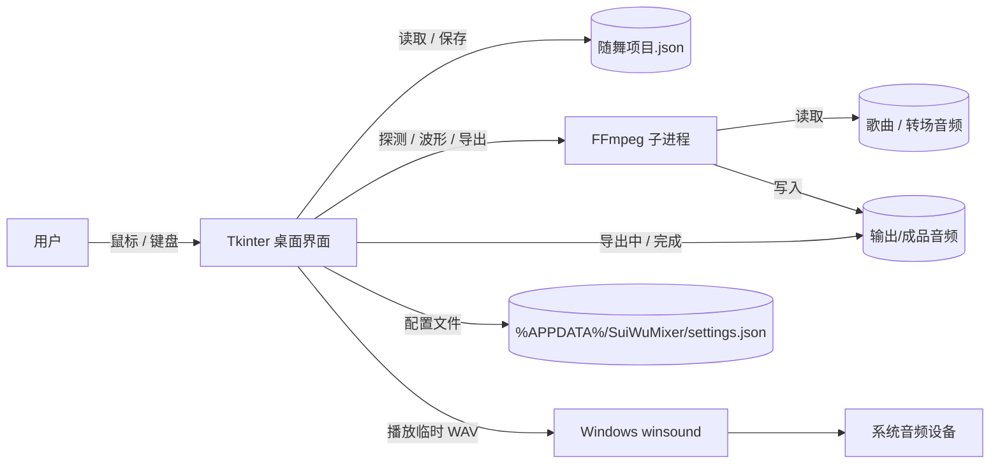

### 3.2 分层结构

| 层 | 模块 | 职责 |
| --- | --- | --- |
| 表现层 | `svdj/ui.py`、`svdj/widgets.py`、`svdj/theme.py` | 窗口、布局、事件、绘制、主题 |
| 应用编排 | `SuibuApp` | 项目生命周期、后台任务调度、状态机、撤销历史、用户交互 |
| 领域模型 | `svdj/project.py` | `Track`、`Project`、设置对象、JSON 持久化 |
| 历史管理 | `svdj/history.py` | 有界快照栈、撤销 / 重做、动作标签 |
| 音频基础设施 | `svdj/audio.py` | FFmpeg 探测、波形、预览、滤镜、导出、错误 |
| 播放适配 | `svdj/playback.py` | `winsound` 异步播放与计时 |
| 启动 / 打包 | `app.py`、`tools/launcher.cs`、`启动随舞剪辑台.cmd` | 入口、便携启动、无控制台启动 |

### 3.3 模块依赖

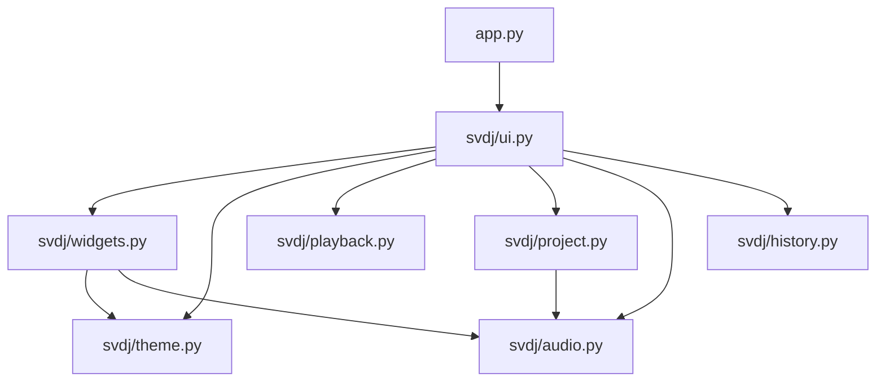

依赖规则：

- `audio.py` 不依赖 UI，可独立测试。
- `project.py` 只依赖 `audio.py` 的常量、排序和扫描函数。
- `widgets.py` 只负责可复用控件，不访问项目状态。
- `history.py` 只管理快照栈，不知道 Tk 或项目结构。
- `ui.py` 是唯一将模型、后台任务、历史和界面组合起来的模块。
- 没有循环导入；`app.py` 只做路径修正和调用 `main()`。

### 3.4 运行时进程视图

```text
随舞剪辑台.exe (C# .NET Framework, 仅 40 KB)
        │  计算 baseDir，校验 runtime/pythonw.exe 与 app.py
        ▼
runtime/pythonw.exe app.py [project-folder]
        │  无控制台窗口；PYTHONUTF8=1
        ▼
Tk 主线程
  ├─ UI 事件循环（after 50ms 轮询事件队列）
  ├─ 音频探测线程（按顺序处理待探测曲目）
  ├─ 波形线程（按当前曲目，token 防止过期结果）
  ├─ 试听渲染线程（segment / transition）
  └─ 导出线程（FFmpeg 子进程 + 进度管道）
        │
        └─ bin/ffmpeg.exe（每次任务一个独立子进程）
```

便携包使用系统 FFmpeg 的独立副本，不修改 PATH，也不安装任何服务。

### 3.5 源码目录

```text
随舞自动机/
├─ app.py                    程序入口，修正 sys.path 后调用 svdj.ui.main
├─ svdj/
│  ├─ __init__.py            版本号
│  ├─ audio.py               FFmpeg 封装、波形、导出计划、进度和取消
│  ├─ project.py             Track / TransitionSettings / Project / JSON
│  ├─ history.py             有界快照撤销 / 重做栈
│  ├─ ui.py                  主窗口、布局、交互、事件循环、状态机
│  ├─ widgets.py             圆角按钮、卡片、波形、进度条、时间输入、Tooltip
│  ├─ theme.py               调色板、字体选择、ttk 样式
│  └─ playback.py            winsound 异步试听
├─ bin/ffmpeg.exe            随包 FFmpeg
├─ assets/                   应用图标 PNG / ICO
├─ docs/
│  ├─ preview.png            界面截图
│  └─ 开发文档.md            本文档
├─ tools/
│  ├─ launcher.cs            便携启动器源码
│  └─ make_assets.py         无第三方依赖的图标生成器
├─ tests/test_core.py        音频 / 项目集成测试
├─ tests/test_history.py     撤销 / 重做单元测试
├─ runtime/                  仅发布包包含：精简 Python 运行时
├─ licenses/                 LGPL / GPL 等第三方许可
├─ README.md                 用户说明
├─ THIRD_PARTY_NOTICES.md    第三方组件声明
├─ LICENSE                   MIT
├─ 启动随舞剪辑台.cmd         便携运行兜底
└─ dist/                     发布产物
```

### 3.6 关键设计决策

| 决策 | 选择 | 理由 | 代价 |
| --- | --- | --- | --- |
| GUI 框架 | Tkinter | Python 标准库、无额外依赖、易随包 | 视觉需自绘，控件能力有限 |
| 音频处理 | 外部 FFmpeg | 格式覆盖广、滤镜强、稳定 | 需随包约 52 MB 二进制 |
| 导出方式 | 单个 `filter_complex` 一次编码 | 无中间文件、无二次压缩、速度快 | 所有输入同时打开；超长歌单有句柄压力 |
| 波形 | 预计算峰值桶 | 绘制快、内存小 | 不能直接做采样级缩放 |
| 工程格式 | JSON | 可读、可手工修复、无数据库 | 无事务、无并发写保护 |
| 撤销 / 重做 | 不可变快照栈 | 实现简单、覆盖所有模型字段 | 大歌单内存随步数增长；非用户元数据需同步基线 |
| 自动保存 | 650ms 去抖 + 关闭保存 | 用户无需手动保存 | 频繁磁盘写入；异常时覆盖风险 |
| 试听 | 渲染临时 WAV + `winsound` | 零依赖、稳定 | 只支持 WAV；不能边播边 seek |
| 发布 | 精简 Python 运行时 + 小型启动器 | 免安装、无需 PyInstaller | 文件夹较大；exe 未签名 |

---

## 4. 数据设计

### 4.1 领域模型

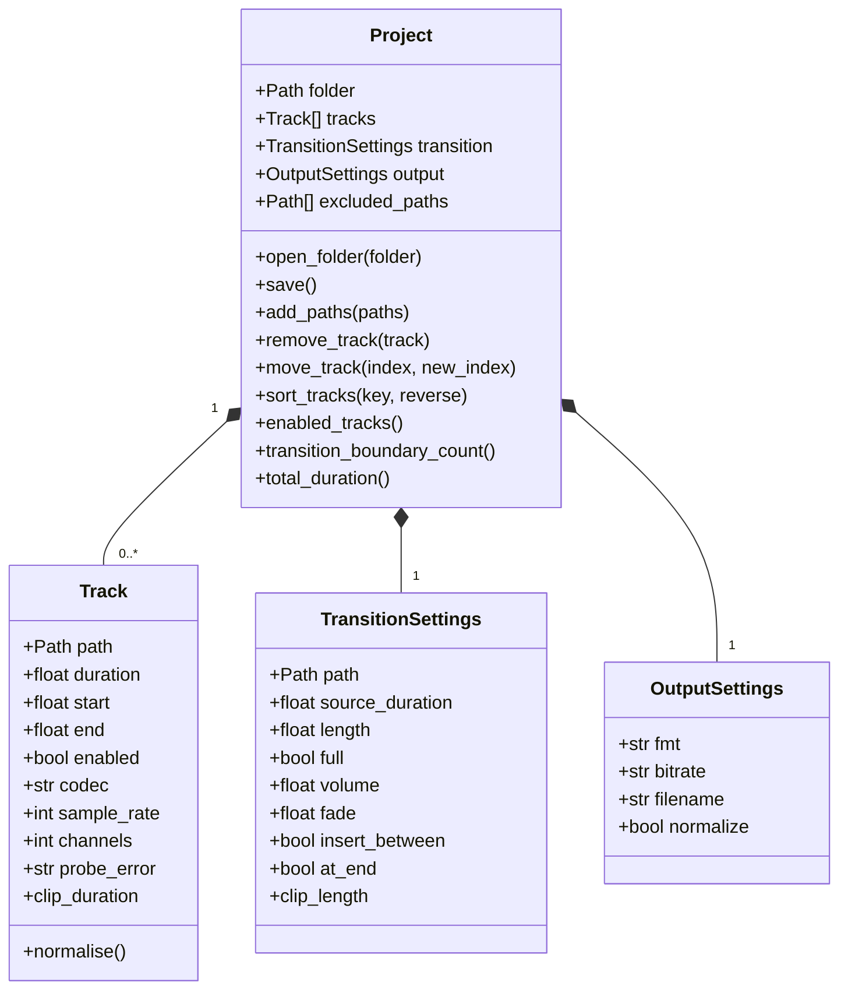

### 4.2 Track

| 字段 | 类型 | 默认值 | 持久化 | 说明 |
| --- | --- | --- | --- | --- |
| `path` | `Path` | 必填 | 是（路径字符串） | 音频绝对路径；保存时优先转换相对路径 |
| `duration` | `float` | `0.0` | 是 | 源音频时长（秒），由 FFmpeg 探测 |
| `start` | `float` | `0.0` | 是 | 入点（秒），含 |
| `end` | `float` | `0.0` | 是 | 出点（秒），不含；`0` 表示尚未设置 |
| `enabled` | `bool` | `True` | 是 | 是否参与导出 |
| `codec` | `str` | `""` | 是 | 例如 `mp3`、`flac`、`aac` |
| `sample_rate` | `int` | `0` | 是 | 源采样率 |
| `channels` | `int` | `0` | 是 | 源声道数；未知时探测默认 2 |
| `probe_error` | `str` | `""` | 否 | 运行时探测错误，用于显示“失败”状态 |
| `stored_path` | `str` | `""` | 否 | 内存中的原始路径形式，便于诊断 |

派生属性 / 方法：

- `name`：`path.name`，只包含文件名。
- `clip_duration`：`end > 0` 时为 `max(0, end - start)`；否则在 `duration > 0` 时返回 `duration`。
- `is_missing`：`not path.is_file()`，任何 `OSError` 视为缺失。
- `normalise()`：把 `start/end` 夹紧到 `[0, duration]`，保证至少 0.05 秒；`duration <= 0` 时把 `end` 归零，等待探测。
- `metadata_text()`：拼接编码、采样率（kHz）和单声道 / 立体声。

### 4.3 TransitionSettings

| 字段 | 类型 | 默认 | 约束 | 说明 |
| --- | --- | --- | --- | --- |
| `path` | `Path \| None` | `None` | 可为空 | 默认转场音频 |
| `source_duration` | `float` | `0.0` | ≥0 | 转场源时长，异步探测 |
| `length` | `float` | `2.5` | 0.2–30 秒 | 请求的转场长度 |
| `full` | `bool` | `False` | — | 为真时忽略 `length`，使用完整转场 |
| `volume` | `float` | `0.85` | 0–1.5 | UI 用 0–150% 表示 |
| `fade` | `float` | `0.18` | 0–5 秒 | 转场首尾淡化；实际不超过 `clip_length/3` |
| `insert_between` | `bool` | `True` | — | 在每两首歌之间插入 |
| `at_end` | `bool` | `False` | — | 在最后一首后插入一次 |

`clip_length` 的计算：

```text
如果 path 为空：0
否则如果 full：source_duration
否则：min(length, source_duration)
最终不小于 0.05 秒
```

`validate()` 对 `length/volume/fade` 做范围夹紧；`source_duration` 由探测流程填写。

### 4.4 OutputSettings

| 字段 | 类型 | 默认 | 说明 |
| --- | --- | --- | --- |
| `fmt` | `str` | `mp3` | 允许 `mp3`、`wav`、`m4a`、`flac` |
| `bitrate` | `str` | `320k` | MP3 / M4A 使用；WAV / FLAC 忽略 |
| `filename` | `str` | 空 | 为空时生成 `随舞混剪_YYYYMMDD_HHMM.<fmt>` |
| `normalize` | `bool` | `False` | 导出时启用单遍 `loudnorm`（约 -14 LUFS） |

### 4.5 Project 聚合

| 字段 | 说明 |
| --- | --- |
| `folder` | 项目根目录，绝对路径 |
| `tracks` | 有序曲目列表；顺序就是导出顺序 |
| `transition` | 默认转场设置 |
| `output` | 导出格式、码率、文件名、统一响度开关 |
| `warnings` | 打开项目时产生的非致命提示（如发现新歌） |
| `excluded_paths` | 用户主动移除、不应被自动扫描加回的路径 |
| `dirty` | 是否有未保存修改，供 UI 判断；保存后置 False |

### 4.6 工程 JSON 示例

```json
{
  "app": "随舞剪辑台",
  "version": 1,
  "updated_at": "2026-10-31T10:00:00",
  "tracks": [
    {
      "path": "01 - Neon Pulse.mp3",
      "duration": 22.05,
      "start": 4.0,
      "end": 19.5,
      "enabled": true,
      "codec": "mp3",
      "sample_rate": 44100,
      "channels": 1
    },
    {
      "path": "02 - 心跳 128.mp3",
      "duration": 18.05,
      "start": 2.5,
      "end": 16.0,
      "enabled": true,
      "codec": "mp3",
      "sample_rate": 44100,
      "channels": 1
    }
  ],
  "excluded": [
    "99 - 已移除.mp3"
  ],
  "transition": {
    "path": "素材/转场 - Impact.mp3",
    "duration": 3.45,
    "length": 2.5,
    "full": false,
    "volume": 0.8,
    "fade": 0.18,
    "insert_between": true,
    "at_end": false
  },
  "output": {
    "format": "mp3",
    "bitrate": "320k",
    "filename": "随舞混剪_20261031_1000.mp3",
    "normalize": false
  }
}
```

字段说明：

| JSON 字段 | 对应模型 | 备注 |
| --- | --- | --- |
| `app` | 常量 | 固定为 `随舞剪辑台`，当前读取时不强校验 |
| `version` | `PROJECT_VERSION` | 当前为 `1` |
| `updated_at` | 无 | 本地时间 `ISO 8601`，秒级，无时区 |
| `tracks[].path` | `Track.path` | 相对项目根或绝对路径 |
| `tracks[].start/end` | `Track.start/end` | 秒，保留 3 位小数 |
| `excluded` | `Project.excluded_paths` | 字符串数组 |
| `transition.duration` | `source_duration` | 源文件完整时长 |
| `output.format` | `OutputSettings.fmt` | 不是 `tracks[].duration` |
| `output.filename` | `OutputSettings.filename` | 可为仅文件名 |
| `output.normalize` | `OutputSettings.normalize` | 可选，旧工程缺省 `false` |

完整 JSON Schema 见附录 C。

### 4.7 路径规则

保存时：

```text
path 位于 project.folder 内  →  as_posix() 相对路径
否则                      →  str(path) 绝对路径
```

读取时：

```text
相对路径  →  project.folder / path
绝对路径  →  直接 expanduser().resolve()
```

规则与影响：

- 项目文件夹整体移动时，内部歌曲仍可找到。
- 外部的歌曲 / 转场以绝对路径保存，移动后需手动重新选择。
- `_path_key()` 对路径执行 `resolve()`、`normcase()`、`casefold()`，在 Windows 上不区分大小写，用于去重。
- 转场文件会在项目加载和选择时从 `tracks` 移除，避免同一文件被当成歌曲。
- `excluded` 只影响自动扫描，不阻止用户通过“添加”重新导入；重新导入会从排除列表移除。

### 4.8 保存与加载

工程文件固定名为 `随舞项目.json`，UTF-8 无 BOM 写入。

保存流程：

```text
构造 dict → json.dumps(ensure_ascii=False, indent=2)
         → 写入 随舞项目.json.tmp
         → os.replace() 原子替换
         → 失败时尝试直接覆盖写入目标文件
         → 标记 dirty = False
```

加载流程：

```text
Project.open_folder(folder)
  ├─ 若 随舞项目.json 存在且合法：读取设置、曲目、排除列表
  ├─ 否则：创建空项目并扫描文件夹顶层音频
  ├─ 若 add_new_files=True：把未在工程、未排除、非转场的新音频追加到末尾
  ├─ 从曲目列表移除当前转场文件
  ├─ 补齐默认文件名
  └─ 返回 Project（warnings 记录新歌、读取失败等）
```

边界行为：

- 缺失字段使用代码默认值；未知字段被忽略。
- 非法 JSON 或非法结构会让 `_from_file()` 抛异常；`open_folder()` 捕获后按新项目重建，并把错误写入 `warnings`。随后 UI 会保存新工程，可能覆盖原损坏文件；重要工程应先备份。该风险已记录在“已知限制”。
- `version` 当前不做迁移；未来版本应在 `_from_file()` 中增加迁移分支。

### 4.9 用户设置文件

除项目外，应用还在用户配置目录保存最后打开的项目：

```text
%APPDATA%\SuiWuMixer\settings.json
```

内容示例：

```json
{
  "last_project": "C:\\Music\\随舞歌单"
}
```

用途：

- 启动时若未传文件夹参数，且没有 `--blank`，自动恢复上次项目；
- 加载失败或被忽略时不阻塞启动；
- 不包含歌曲音频或工程数据。

### 4.10 派生值与不变量

**边界数量：**

```text
boundaries = 0
if transition.path:
    if insert_between: boundaries += max(0, enabled_tracks - 1)
    if at_end and enabled_tracks > 0: boundaries += 1
```

**预计成片时长：**

```text
sum(track.clip_duration for enabled tracks)
+ transition.clip_length × boundaries
```

**输出路径：**

```text
project.folder / "输出" / basename(output.filename)
```

`output_path()` 使用 `Path(name).name` 丢弃目录部分，避免 `../` 逃出输出目录；无扩展名时补当前格式扩展名。

**核心不变量：**

- `current_track` 必须为 `None` 或 `project.tracks` 中的元素。
- `0 <= start < end <= duration`（完整数据下）；最短选段 0.15 秒（UI 层），模型层最小 0.05 秒（防御性）。
- `transition.path` 不会同时出现在 `tracks` 中。
- 只有存在转场路径且相应开关打开时，才产生边界。
- 后台线程不直接访问 Tk 控件，只通过 `events` 队列回传。

### 4.11 撤销 / 重做状态

历史管理采用**快照栈**，不记录增量 diff：

```text
state = {
  current: 当前选中曲目的绝对路径或 None,
  tracks: [{path, start, end, enabled, duration, codec, sample_rate, channels}],
  excluded: [路径],
  transition: {path, source_duration, length, full, volume, fade, insert_between, at_end},
  output: {fmt, bitrate, filename, normalize},
}
```

规则：

- 每次用户编辑完成后调用 `_record_history(label)`；状态与基线相同则不入栈。
- `HistoryManager` 最多保留 100 步；超出上限丢弃最旧项。
- 撤销时把当前状态压入 redo 栈，恢复 undo 栈顶；重做反之。
- 恢复时优先复用当前项目中同路径的 `Track` 对象，只覆盖 `start/end/enabled`，保留最新的 `duration/codec` 等探测元数据；被撤销删除的曲目则用快照元数据重建。
- 异步探测、波形分析、转场探测更新的是元数据，通过 `_sync_history_baseline()` 同步基线，不产生撤销步骤。
- 波形拖动期间设置 `_wave_dragging`，暂停基线同步，保证一次拖动对应一个撤销步骤。
- 打开 / 重新扫描项目会清空历史。
- 历史只覆盖模型编辑，不覆盖缩放视口、试听起点、窗口尺寸等视图状态。
- 导出期间禁用撤销 / 重做，避免输出与工程状态错位。

动作标签示例：`调整选段`、`快速选区`、`启用或停用歌曲`、`排序歌曲`、`拖拽排序`、`移除歌曲`、`选择转场音频`、`调整转场音量`、`修改导出格式`、`切换统一响度`。状态栏显示“已撤销 / 已重做：<标签>”。

---

## 5. 音频引擎

### 5.1 FFmpeg 定位

`find_ffmpeg()` 按以下顺序寻找可执行文件，返回第一个存在者：

1. `<app_root>/bin/ffmpeg.exe`
2. `<app_root>/ffmpeg.exe`
3. `<Python 可执行文件目录>/bin/ffmpeg.exe`
4. 系统 `PATH` 上的 `ffmpeg`
5. 可选的 `imageio_ffmpeg.get_ffmpeg_exe()`

`app_root()`：

- 普通源码运行：`svdj/audio.py` 的上两级，即项目根目录；
- 若被 PyInstaller 等冻结：`sys._MEIPASS` 或可执行文件目录。

找不到时抛出 `AudioError`，文案提示检查 `bin\ffmpeg.exe` 或 `PATH`。

### 5.2 子进程调用约定

所有 FFmpeg 调用遵循：

- 参数使用 `list[str]`，`shell=False`（默认）；不拼接命令字符串，避免路径空格和命令注入。
- Windows 下设置 `CREATE_NO_WINDOW` + `STARTF_USESHOWWINDOW`，不闪控制台。
- 元数据和波形：`stdout=DEVNULL/PIPE`，`stderr=PIPE`。
- 错误消息取 stderr 最后一条非空行，超过 500 字符截断（`_short_error()`）。
- `probe_audio()` 只读取文件信息，不完整解码。
- 导出使用独立 `Popen`，不阻塞 Tk 主线程。

### 5.3 音频探测

命令：

```powershell
ffmpeg -hide_banner -nostdin -i "<file>"
```

FFmpeg 在只提供信息时通常以非 0 返回，但 stderr 已包含元数据。解析：

```text
Duration: HH:MM:SS.mmm
Audio: <codec>, <sample_rate> Hz, <channel_layout>
```

得到：

- `duration`：秒；
- `codec`：如 `mp3`；
- `sample_rate`；
- `channels`：`mono`/`1 channel` → 1，`stereo`/`2 channels` → 2，未知默认 2。

失败条件：

- 文件不存在：`AudioError("音频文件不存在…")`
- 无 `Duration:`：`AudioError("无法读取音频时长…")`

探测结果通过 `probe_done` / `probe_error` 事件回到 UI。`probe_error` 仅用于显示和重试，不持久化。

### 5.4 波形分析

命令：

```powershell
ffmpeg -v error -nostdin -i "<file>" -map 0:a:0 -vn `
  -ac 1 -ar 2500 -f s16le pipe:1
```

步骤：

1. 以 2500 Hz 单声道 s16le 解码整首音频到内存。
2. 将字节解释为 `array('h')`；非小端平台执行 `byteswap()`。
3. `duration = 样本数 / 2500`。
4. `step = max(1, 样本数 // buckets)`，默认 `buckets=1100`。
5. 每个 bucket 取 `max(max(chunk), -min(chunk)) / 32768` 作为峰值。
6. 静音阈值：最大峰值 `< 0.0008` 时全部归零。
7. 归一化：
   - 参考值 = 第 99 百分位峰值；
   - 参考值下限 = `absolute_peak * 0.45` 和 `1e-6`；
   - 显示值 = `min(1, (p / reference) ** 0.72)`。
8. 返回 `Waveform(duration, peaks)`。

设计说明：

- 2500 Hz 足以表达响度包络，同时将 10 分钟音频的原始内存控制在约 3 MB。
- 99 百分位避免单个尖峰把整首波形压平。
- 0.72 次幂提高弱段的可视对比度。
- 函数默认 `buckets=1100`；UI 为支持缩放请求 `buckets=4000`（约 32 KB / 首）。
- 波形数据在 UI 层以 `(path, mtime_ns, size)` 为键做 LRU 缓存，最多 8 首。

已知限制：

- 无波形缩放 / 横向滚动，细节受控件宽度限制。
- 波形只表达峰值，不做 RMS / 频谱显示。
- 音频文件变化后，mtime/size 变化会使缓存失效；文件内容变化但 mtime/size 不变时缓存可能过期（极少见）。

### 5.5 试听渲染

试听统一转成临时 WAV，由 Windows `winsound` 异步播放。

命令要点：

```powershell
ffmpeg -y -v error -nostdin -ss <start> -i "<source>" -t <length> `
  -map 0:a:0 -vn -ac 2 -ar 44100 -c:a pcm_s16le "<temp>.wav"
```

- `-ss` 位于 `-i` 前，属于快速输入 seek；精度受容器影响，试听可接受，正式裁剪由导出滤镜保证。
- `volume` 通过 `-af volume=<x>` 应用（若不为 1）。
- 输出 44.1kHz / 立体声 / 16-bit PCM，兼容 `winsound`。
- 临时目录优先级：
  1. `%TEMP%\suibu_preview_<pid>`
  2. 当前工作目录 `.preview_cache`
  3. 系统临时目录
- 退出时 `shutil.rmtree(temp_dir)`。

`PreviewPlayer`：

- `winsound.PlaySound(file, SND_FILENAME | SND_ASYNC | SND_NODEFAULT)`
- 每 60ms 计算 `time.monotonic() - started`，通知 UI 更新游标；
- 到时自动 `stop()` 并调用 `on_finished`；
- 停止调用 `winsound.PlaySound(None, SND_PURGE)`；
- 无 `winsound`（非 Windows）时抛 `RuntimeError`。

### 5.6 导出计划

#### 5.6.1 输入规格

UI 在开始导出时把 `Track` 转换为：

- `ClipSpec(path, start, end, name)`
- `TransitionSpec(path, source_duration, length, full, volume, fade, insert_between, at_end)`

`build_export_plan()` 过滤掉 `duration <= 0.05` 的选段；若为空抛 `AudioError`。

#### 5.6.2 边界计算

```text
boundaries = 0
if transition and transition.insert_between:
    boundaries += max(0, len(clips) - 1)
if transition and transition.at_end and len(clips) > 0:
    boundaries += 1
```

如果 `boundaries > 0` 但转场文件缺失，立即报错。

#### 5.6.3 单曲滤镜链

每首歌：

```text
[<i>:a]
  atrim=start=<start>:end=<end>,
  asetpts=PTS-STARTPTS,
  aresample=48000,
  aformat=sample_fmts=fltp:sample_rates=48000:channel_layouts=stereo,
  afade=t=in:st=0:d=<fade>,
  afade=t=out:st=<duration-fade>:d=<fade>
[s<i>]
```

其中 `fade = min(0.06, duration / 4)`，时长极短时自动减小；`fade <= 0.005` 时省略淡变。统一 48kHz / 立体声 / fltp 是为了让 `concat` 的输入完全一致。

#### 5.6.4 转场滤镜链

转场文件只作为第 `len(clips)` 个输入，通过 `asplit` 复制到每个边界：

```text
[<t>:a]asplit=N[tw0][tw1]...
```

每个副本：

```text
[twK]
  atrim=start=0:end=<transition_clip>,
  asetpts=PTS-STARTPTS,
  aresample=48000,
  aformat=sample_fmts=fltp:sample_rates=48000:channel_layouts=stereo,
  volume=<volume>,
  afade=t=in:st=0:d=<fade>,
  afade=t=out:st=<transition_clip-fade>:d=<fade>
[trK]
```

- `transition_clip = transition.clip_length`。
- `fade = min(transition.fade, transition_clip / 3)`，避免淡变重叠。
- 音量限制在 0–1.5。

#### 5.6.5 拼接

按顺序组成：

```text
[s0] [tr0] [s1] [tr1] ... [sN] [trLast?]
```

最后：

```text
concat=n=<count>:v=0:a=1[out]
```

单段且无转场时使用 `anull`，避免不必要的 concat：

```text
[s0]anull[out]
```

#### 5.6.6 完整滤镜脚本示例

两首歌，各 30 秒，转场 2.5 秒，曲目之间 + 片尾：

```text
[0:a]atrim=start=10:end=40,asetpts=PTS-STARTPTS,aresample=48000,aformat=sample_fmts=fltp:sample_rates=48000:channel_layouts=stereo,afade=t=in:st=0:d=0.06,afade=t=out:st=29.94:d=0.06[s0];
[1:a]atrim=start=5:end=35,asetpts=PTS-STARTPTS,aresample=48000,aformat=sample_fmts=fltp:sample_rates=48000:channel_layouts=stereo,afade=t=in:st=0:d=0.06,afade=t=out:st=29.94:d=0.06[s1];
[2:a]asplit=2[tw0][tw1];
[tw0]atrim=start=0:end=2.5,asetpts=PTS-STARTPTS,aresample=48000,aformat=sample_fmts=fltp:sample_rates=48000:channel_layouts=stereo,volume=0.85,afade=t=in:st=0:d=0.18,afade=t=out:st=2.32:d=0.18[tr0];
[tw1]atrim=start=0:end=2.5,asetpts=PTS-STARTPTS,aresample=48000,aformat=sample_fmts=fltp:sample_rates=48000:channel_layouts=stereo,volume=0.85,afade=t=in:st=0:d=0.18,afade=t=out:st=2.32:d=0.18[tr1];
[s0][tr0][s1][tr1]concat=n=4:v=0:a=1[out]
```

预计时长 = `30 + 30 + 2 × 2.5 = 65 秒`。

#### 5.6.7 帧级时间与精度

- 所有时间用秒，保留 3 位小数传入滤镜。
- `atrim` 在解码后按时间戳裁剪，精度高于试听的输入 seek。
- 源文件时长来自文件头，可能存在几十毫秒误差；最终成品以 FFmpeg 实际解码为准。
- MP3 / AAC 编码会引入编码器延迟，最终时长与理论值可能相差几十毫秒。

### 5.7 导出命令与编码参数

命令结构：

```powershell
ffmpeg -y -hide_banner -loglevel error -progress pipe:1 -nostats `
  -i "<song1>" -i "<song2>" -i "<transition>" `
  -filter_complex_script "<filter.txt>" `
  -map "[out]" -vn -ar 48000 -ac 2 `
  -metadata "title=随舞混剪" -map_metadata -1 `
  <编码参数> "<output>"
```

| 格式 | 编码器 | 参数 | 说明 |
| --- | --- | --- | --- |
| MP3 | `libmp3lame` | `-b:a 320k/256k/192k`，`-id3v2_version 3` | 兼容性好 |
| WAV | `pcm_s16le` | — | 无损 PCM，体积最大 |
| M4A | `aac` | `-b:a <bitrate>`，`-movflags +faststart` | 适合分享 / 移动端 |
| FLAC | `flac` | `-compression_level 5` | 无损压缩 |

统一输出 `-ar 48000 -ac 2`。`-map_metadata -1` 移除源文件元数据，只写入标题。

#### 5.7.1 统一响度（可选）

`build_export_plan(..., normalize=True)` 会在 `concat` 之后追加：

```text
[out]loudnorm=I=-14:TP=-1.5:LRA=11[normalized]
```

- 目标常量：`LOUDNESS_TARGET=-14.0`、`LOUDNESS_PEAK=-1.5`、`LOUDNESS_RANGE=11.0`。
- `export_command()` 在 `normalize=True` 时映射 `[normalized]`，否则映射 `[out]`。
- 编码仍由全局 `-ar 48000 -ac 2` 统一到 48kHz 立体声。
- 采用单遍动态 `loudnorm`，实现简单、兼容性好；它会根据节目动态调整增益，极端动态素材可能有轻微“抽吸”。需要更高精度时可扩展为两遍测量。
- 响度滤镜不改变选段 / 转场的编辑语义，预计时长仍按拼接长度计算。
- UI 位于“导出设置”标题栏的“统一响度”复选框，默认关闭，设置随工程保存。

### 5.8 进度与取消

- FFmpeg 使用 `-progress pipe:1`，每约 0.5 秒输出 `key=value`。
- `run_export()` 读取 `out_time_us` / `out_time_ms` 并折算为秒（两者都按微秒处理）。
- 进度 = `elapsed / plan.total_duration`，上限 0.995；结束时显式上报 1.0。
- 取消机制：
  - UI 设置 `threading.Event`；
  - 读进度循环每个事件检查一次；
  - 已取消则 `process.terminate()`，等待退出，删除未完成的输出文件；
  - 抛 `AudioCancelled`，UI 隐藏取消按钮并恢复空闲状态。
- 取消延迟取决于 FFmpeg 下一次输出进度，通常小于 1 秒。

### 5.9 输出文件与重名

- 输出目录：`<project>/输出`。
- 文件名：`OutputSettings.filename`，强制扩展名与格式一致。
- `make_unique_path()` 对同名文件依次尝试 `名称 (2).ext`、`名称 (3).ext`，最多 999。
- UI 会把最终唯一文件名写回工程，避免下次继续撞名。

### 5.10 复杂度与性能

| 操作 | 主要成本 | 当前策略 |
| --- | --- | --- |
| 探测 | 启动 FFmpeg + 读文件头 | 顺序处理，不阻塞 UI |
| 波形 | 整首解码 + Python 循环 | 2.5kHz 采样、峰值桶、8 首缓存 |
| 试听 | 一次短片段编码 | 后台线程；临时 WAV |
| 导出 | 单次 FFmpeg 全量解码 + 编码 | 无中间文件，单次编码 |
| 界面刷新 | Canvas 约 350 条线段 | 仅在必要时重绘；拖拽实时重绘 |

导出的一次性滤镜方案避免了“逐段导出再拼接”的重复编码，但会同时打开所有输入文件。对于数百首歌曲的超长歌单，文件句柄和滤镜图规模会成为主要风险，建议分批制作。

---

## 6. 界面与交互设计

### 6.1 视觉语言

| 语义 | 颜色 | 用途 |
| --- | --- | --- |
| 背景 | `#0C0F15` | 根窗口 |
| 卡片 | `#151A23` | 面板 |
| 输入框 | `#0F131A` | 文本框、波形底 |
| 主色 | `#8B6CFF` | 主按钮、选中态、强调 |
| 成功 / 入点 | `#43D7A3` | 状态、绿色把手 |
| 警告 / 出点 | `#FFB35F` | 警告、橙色把手 |
| 错误 | `#FF6B7A` | 错误状态、缺失文件 |
| 正文 | `#F3F6FC` | 主要文字 |

实现文件：`svdj/theme.py`。

字体策略：

- 界面字体优先 `Microsoft YaHei UI`，其次 `Microsoft YaHei`、`PingFang SC`、`Segoe UI`。
- 等宽字体优先 `Cascadia Mono`，其次 `Consolas`、`Courier New`。
- Tk 的 `clam` 主题为基础，自定义 Treeview、Combobox、Checkbutton、Scale、Scrollbar。

### 6.2 窗口结构

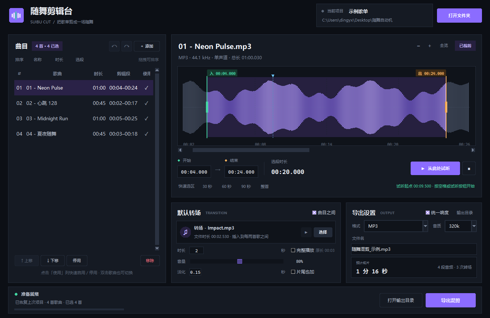

```text
┌────────────────────────────────────────────────────────────────────┐
│ Logo  随舞剪辑台 / SUIBU CUT        当前项目 chip      打开文件夹  │  header 76px
├───────────────────────┬────────────────────────────────────────────┤
│ 曲目列表              │ 选段编辑                                   │
│ 4 首 · 4 已选         │ 歌名 / 格式 / 总长                          │
│ 排序 名称 时长 选段   │ ┌────────────────────────────────────────┐ │
│ ┌───────────────────┐ │ │          波形 + 选段 + 标尺            │ │
│ │# 歌曲 时长 选段 用│ │ └────────────────────────────────────────┘ │
│ │01 ...             │ │ 开始 → 结束  选段时长   试听 / 停止        │
│ │...                │ │ 快速选区 30/60/90/整首      提示            │
│ └───────────────────┘ ├──────────────────┬─────────────────────────┤
│ 上移 下移 停用 移除   │ 默认转场         │ 导出设置                 │
│                       │ 文件 / 时长 / 音量│ 格式 / 音质 / 文件名     │
│                       │ 淡化 / 片尾       │ 预计成片 / 输出目录      │
├───────────────────────┴──────────────────┴─────────────────────────┤
│ 状态 + 进度                             取消  打开输出  导出混剪    │  footer
└────────────────────────────────────────────────────────────────────┘
```

布局参数（`_build_ui`、`_build_header`、`_build_playlist`、`_build_editor`）：

- 根窗口最小 `1160×760`；初始大小由屏幕尺寸计算，最大 `1340×870`。
- 根 `row0` 头部固定 76px；`row1` 内容区权重 1；`row2` 底栏自然高度。
- 左列最小 430px；右列权重 1。
- 右侧上卡（波形）权重 1，最小高度 300；下卡最小高度 220；两卡间距 14。
- 下卡两列权重 6:5，最小宽度 360 / 300。
- 底部状态栏固定约 74px（含边距）。

### 6.3 控件构成

| 控件 | 文件 | 关键能力 |
| --- | --- | --- |
| `Card` | `widgets.py` | 带边框的卡片容器，内部 `body` |
| `RoundedButton` | `widgets.py` | Canvas 自绘圆角按钮；primary / secondary / ghost / quiet / danger / mint |
| `WaveformView` | `widgets.py` | 波形绘制、选区、双把手、拖动、缩放视口、横向滚动、游标、试听起点 |
| `ProgressBar` | `widgets.py` | 圆角进度条 |
| `Tooltip` | `widgets.py` | 600ms 延迟提示，用于项目路径、转场路径 |
| `TimeEntry` | `widgets.py` | 深色时间输入框，回车 / 失焦提交，上下箭头 ±0.1 秒 |
| 主窗口 | `ui.py` | 布局、状态、业务编排 |
| 主题 | `theme.py` | 颜色与 ttk 样式 |

### 6.4 歌单交互

| 操作 | 行为 |
| --- | --- |
| 单击行 | 选中歌曲，加载详情和波形 |
| 点击“使用”列 | 切换启用 / 停用 |
| 双击行（非“使用”列） | 切换启用 / 停用 |
| 拖拽行 | 调整顺序；释放时写入模型 |
| 右键行 | 试听、启用 / 停用、设为整首、在资源管理器显示、移除、重新读取（仅失败时） |
| 上移 / 下移 | 当前歌曲移动一位，边界按钮禁用 |
| 名称 / 时长 / 选段按钮 | 排序；同键再次点击切换升序 / 降序 |
| “＋ 添加” | 多选音频文件加入项目 |
| 撤销 / 重做按钮 | 恢复最近一步模型编辑；按钮 Tooltip 显示动作名 |
| Delete | 移除选中歌曲（需确认） |
| F5 | 重新扫描文件夹 |

行状态：

- 正常：浅色文字；
- 停用：暗灰色；
- 缺失：红色；
- 读取失败：橙色，可在右键菜单重试。

Treeview 列：

| 列 ID | 标题 | 宽度 | 内容 |
| --- | --- | --- | --- |
| `index` | # | 29 | 两位序号 |
| `name` | 歌曲 | 178，可拉伸 | 不含扩展名的文件名 |
| `duration` | 时长 | 47 | `mm:ss`；未读完显示 `…`，失败显示“失败” |
| `clip` | 剪辑段 | 90 | `入点–出点`，`mm:ss` |
| `enabled` | 使用 | 36 | `✓` / `–` |

### 6.5 波形交互状态机

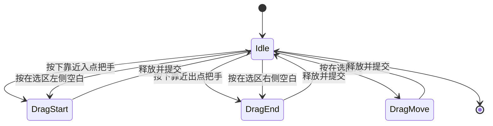

命中规则：

- 距入点 / 出点横坐标 ≤ 8px 时优先命中把手。
- 在选区内部按下为整体平移，记录 `time - start` 偏移。
- 选区左侧空白把入点移到点击位置；右侧空白把出点移到点击位置。
- 底部约 25px 的时间标尺是试听起点区域：点击其中（避开把手）只设置试听起点，不修改选段。
- `Shift + 点击` 任意位置也可设置试听起点，同样不修改选段。
- 右键波形弹出上下文菜单：“从此处试听”“清除试听起点”“全览波形”。
- 拖动过程中 `start/end` 夹紧到 `[0, duration]`，保持 `end - start >= 0.15`。
- 每次拖动实时回调；释放时 `final=True`，写工程并触发自动保存 / 撤销记录。
- 时间值统一四舍五入到 3 位小数。

缩放与滚动：

- 视口为 `[view_start, view_end]`，默认覆盖整首。
- `+` / `−` 按钮以视图中心缩放 1.5 倍；`Ctrl + 滚轮` 以鼠标位置为锚点缩放。
- 普通滚轮左右平移视口；底部水平滚动条可 `moveto` / `scroll`。
- 中键拖动平移视口。
- 最小可视长度 = `max(0.2, duration/200)` 秒；全览时滚动条禁用。
- 缩放 / 滚动只改变视口，不修改工程、不进入撤销历史。

绘制细节：

- 左右边距 16px，顶部 34px，底部 28px。
- 中间轴绘制；每 25% 画垂直虚线；底部 5 个时间刻度（缩放后使用毫秒精度）。
- 波形条每 3px 一根，线宽 2px，圆头；峰值索引按视口时间映射。
- 选中区域用紫色底，未选中用灰色；按峰值做颜色插值。
- 入点绿色 `MINT`，出点橙色 `ORANGE`，顶部标签 `入 mm:ss.mmm` / `出 mm:ss.mmm`。
- 两者标签重叠时，出点标签自动换到第二行。
- 试听起点为浅蓝色虚线 + 顶部三角，与白色播放游标、绿 / 橙边界区分。
- 播放游标为白色竖线 + 顶部三角，超出视口时隐藏。
- 窗口缩放使用 `after_idle` 合并重绘。

### 6.6 时间输入与快速选区

`parse_time()` 接受：

| 输入 | 结果 |
| --- | --- |
| `83.5` | 83.5 秒 |
| `01:23.500` | 83.5 秒 |
| `1:23.5` | 83.5 秒 |
| `1m23.5s` | 83.5 秒 |
| `1：23，5` | 中文标点会被规范为 `1:23.5` |

提交规则：

- 回车或失焦触发 `_apply_time_entries()`。
- 解析失败时显示红色提示，并恢复当前值。
- 入点夹紧到 `[0, duration-0.15]`；出点夹紧到 `[start+0.15, duration]`。
- 若 `end <= start`，自动保持最短 0.15 秒。

快速选区：

```text
30/60/90 秒：
  length = min(requested, duration)
  start  = min(current_start, duration - length)
  end    = start + length

整首：
  start = 0
  end = duration
```

### 6.7 转场面板

控件顺序：

1. “曲目之间”复选框；
2. 文件框：名称、源时长、完整路径 Tooltip、选择按钮、试听按钮；
3. 时长输入 + “完整播放”；
4. 音量 0–150 滑块 + 百分比；
5. 淡化秒数 + “片尾也加”。

行为：

- 选择文件后先更新路径并显示“读取中…”，后台探测完成后填写 `source_duration`。
- 若探测失败：清除路径、弹出错误、状态栏红色提示。
- 若文件位于当前曲目列表：自动从列表移除，避免作为歌曲重复出现。
- 勾选“完整播放”时禁用时长输入；长度输入提交时夹紧 0.2–30 秒。
- 音量 0–150%，UI 0–150 映射 `volume = percent / 100`。
- 淡化 0–5 秒；实际滤镜不超过转场片段长的 1/3。
- 转场试听使用设定长度 / 完整长度，并应用音量。

### 6.8 导出面板

| 控件 | 行为 |
| --- | --- |
| 格式 | MP3 / WAV / M4A (AAC) / FLAC；切换后自动改扩展名 |
| 音质 | MP3 / M4A 可选 320k、256k、192k；WAV / FLAC 禁用 |
| 文件名 | 失焦 / 回车提交；清理 Windows 非法字符，只保留文件名 |
| 统一响度 | 标题栏复选框，默认关闭；启用后追加 `loudnorm`，随工程保存 |
| 预计成片 | 所有启用选段 + 转场总时长 |
| 明细 | `N 段音频 · M 次转场` 或 `无转场` |
| 输出目录 | 创建并打开 `<project>/输出` |

文件名处理：

- 使用 `Path(raw).stem` 去目录和后缀；
- `_sanitize_filename()` 替换 `<>:"/\|?*` 和控制字符为 `_`；
- 去掉末尾空格和点；
- 空名回退“随舞混剪”；
- 强制使用当前格式扩展名。

### 6.9 试听状态机

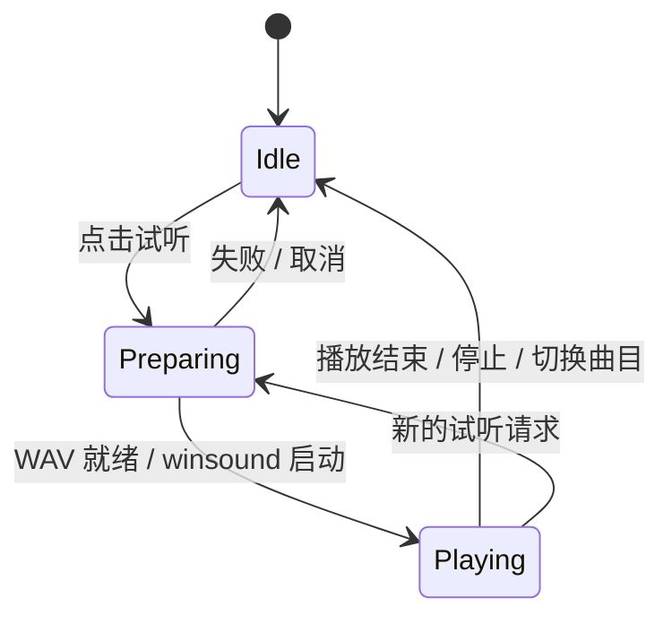

并发保护：

- `_preview_token` 每次请求自增；
- 渲染线程回传 `preview_ready(token)`；
- 只有 token 仍等于当前值才播放，过期结果丢弃；
- `_preview_kind` 区分 `segment` / `transition`；
- `_preview_preparing` 与 `player.is_playing` 共同决定按钮禁用；
- 切换曲目、改时间、关闭窗口都会 `_stop_preview()`。

自定义试听起点：

- 试听起点（audition）由 `WaveformView` 保存，范围限定在当前选段 `[start, end]`。
- 设置方式：点击底部时间标尺、`Shift + 点击` 波形、右键菜单“从此处试听”。
- 起点绘制为浅蓝虚线 + 顶部三角，不进入撤销历史。
- 点击预览 / 按 `Space` 时，若起点有效，从起点播放到 `end`；否则从 `start` 播放。
- 预览按钮文案在“▶ 试听选段”和“▶ 从此处试听”之间切换。
- 拖动选段导致起点越界时自动清除；停止播放不清除起点，方便反复试听。

### 6.10 导出 UI 状态

| 状态 | 导出按钮 | 取消按钮 | 进度条 | 其他 |
| --- | --- | --- | --- | --- |
| 空闲 | 可用（有有效曲目） | 隐藏 | 0 | 可编辑 |
| 导出中 | 禁用，文案“正在导出…” | 显示 | 实时 | 再次打开文件夹被阻止 |
| 完成 | 恢复 | 隐藏 | 1，1.6 秒后归零 | 完成对话框 |
| 失败 | 恢复 | 隐藏 | 0 | 错误对话框 |
| 取消 | 恢复 | 隐藏 | 0 | 状态栏“已取消导出” |

### 6.11 快捷键

| 快捷键 | 作用 | 备注 |
| --- | --- | --- |
| `Ctrl+Z` | 撤销 | 输入框聚焦时交给输入框自身撤销 |
| `Ctrl+Y` / `Ctrl+Shift+Z` | 重做 | 导出中不响应 |
| `Ctrl+O` | 打开文件夹 | 导出中不响应 |
| `Ctrl+S` | 立即保存 | 状态栏提示 |
| `Ctrl+E` | 导出 | 无项目时先选择文件夹 |
| `Space` | 从试听起点 / 选段开头播放；再次按下停止 | 输入框聚焦时不拦截 |
| `Delete` | 移除当前歌曲 | 需要确认；输入框聚焦时不拦截 |
| `F5` | 重新扫描 | 导出中不响应 |
| `Ctrl+滚轮` | 以鼠标位置缩放波形 | 仅波形区域 |
| `Shift+点击` | 设置试听起点 | 仅选段范围内 |

### 6.12 空状态与禁用状态

- 无项目：曲目列表显示“打开一个歌单文件夹开始”；添加、排序、导出、输出目录、撤销 / 重做禁用。
- 有项目无曲目：提示“点「＋ 添加」导入歌曲”；添加可用。
- 无选中曲目：时间输入、快速选区、试听、缩放、上下移、停用、移除禁用。
- 无历史：撤销 / 重做按钮禁用；Tooltip 显示可用动作名。
- 文件缺失 / 读取中：波形显示对应提示；导出按钮在存在缺失或未读完曲目时禁用。
- 无项目：统一响度复选框禁用。
- 导出中：大部分编辑和项目切换禁用，撤销 / 重做禁用，防止输出与界面状态错位。

### 6.13 Windows 集成

- `SetProcessDpiAwareness(1)`：系统 DPI 感知，避免界面模糊。
- `SetCurrentProcessExplicitAppUserModelID("SuiBuCut.Desktop.1")`：任务栏图标分组。
- DWM 深色标题栏：属性 20（immersion），兼容回退 19；caption/text/border 颜色 35/36/34。
- `assets/icon.png` 作为窗口图标；`assets/icon.ico` 用于 exe。
- Explorer 中定位歌曲使用 `explorer /select,<path>`。

---

## 7. 运行时流程、线程与事件

### 7.1 启动流程

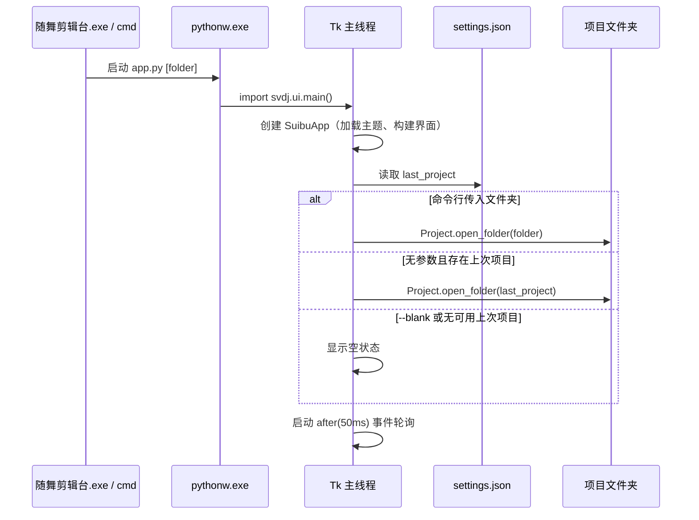

启动参数：

| 参数 | 行为 |
| --- | --- |
| `<folder>` | 打开该文件夹为项目 |
| `--blank` | 忽略上次项目，显示空界面 |
| 无参数 | 尝试恢复 `settings.json` 中的 `last_project` |
| 其他 `--` 参数 | 忽略 |

### 7.2 打开文件夹

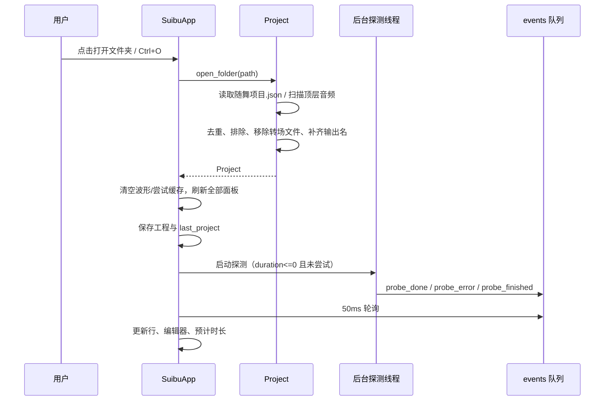

`_start_probe_worker()` 的并发约束：

- `_probing` 为真时不会启动第二个批次；
- `_probe_attempted` 记录已尝试的路径，避免失败后无限重试；
- 一个批次顺序处理所有待探测曲目，避免同时启动大量 FFmpeg；
- `probe_finished` 后再次检查是否有新增待探测曲目，然后保存工程。

### 7.3 选曲与波形

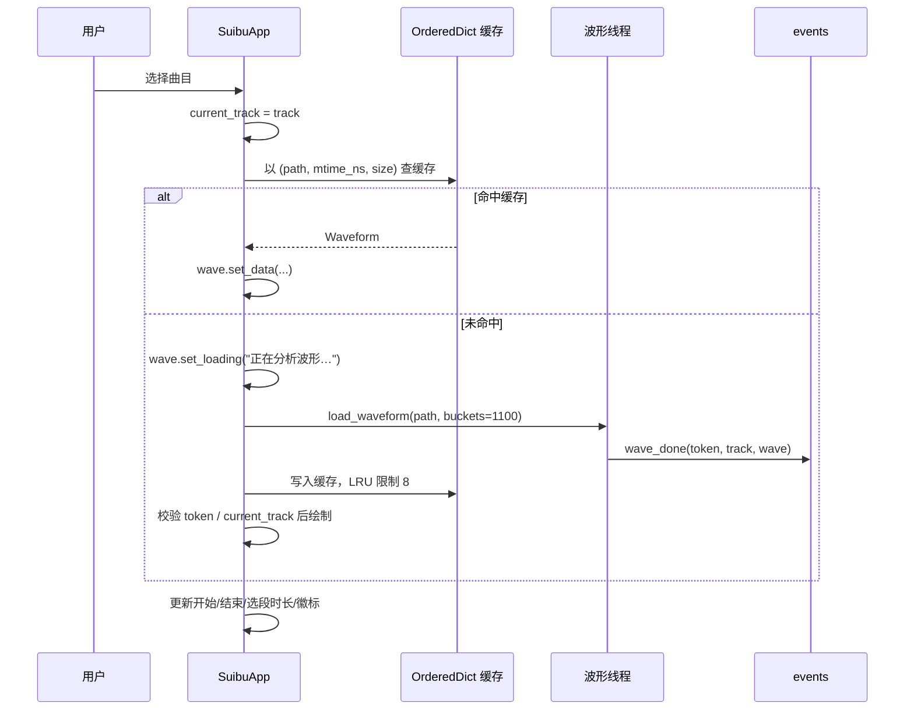

缓存键包含修改时间和大小，因此重新编码或替换歌曲后会自动失效。

### 7.4 试听

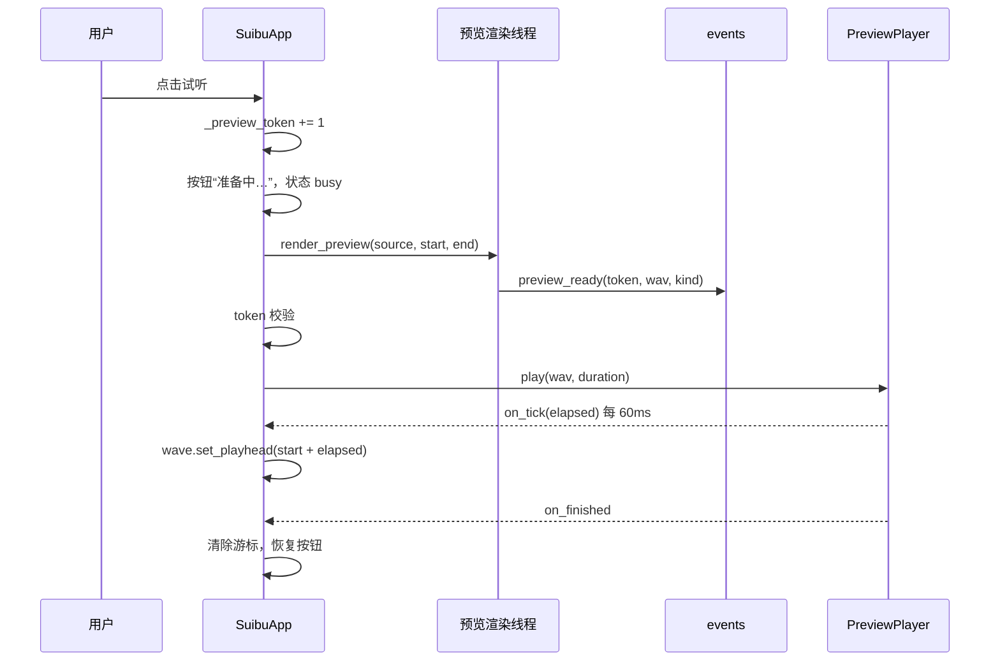

取消 / 切换曲目时：

- `_stop_preview()` 自增 token，使正在渲染的旧任务结果失效；
- 调用 `player.stop()` 停止 `winsound`；
- 清理临时 WAV 在应用退出时统一完成。

### 7.5 导出

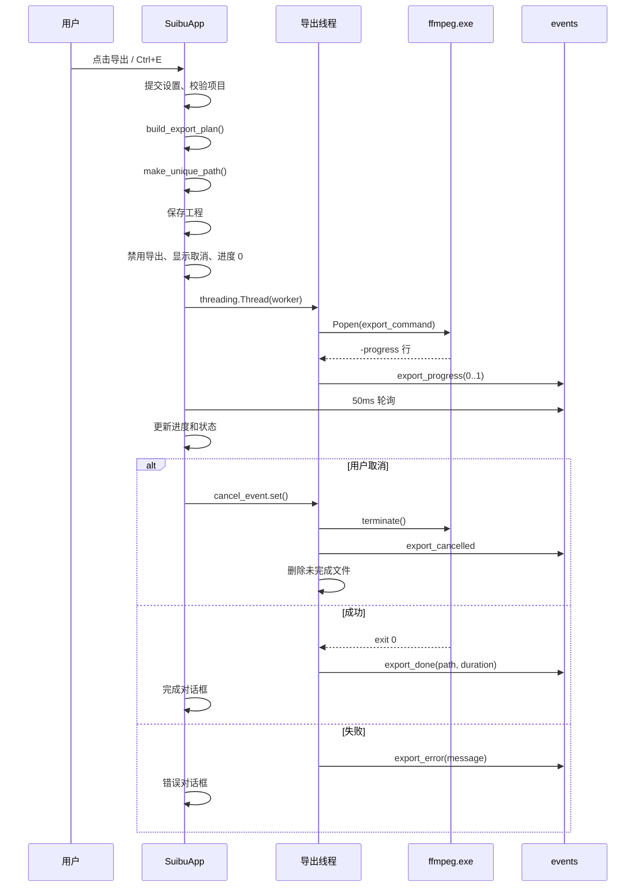

导出期间打开文件夹、重新扫描会被阻止；退出程序会询问是否取消导出。

### 7.6 事件协议

所有后台线程通过 `SuibuApp.events`（`queue.Queue`）发送二元组 `(kind, payload)`；主线程每 50ms 轮询，单次尽可能排空队列。

| `kind` | payload | 生产者 | 主线程处理 |
| --- | --- | --- | --- |
| `probe_done` | `(Track, AudioInfo)` | 探测线程 | 更新时长/编码/采样率，必要时刷新编辑器与波形 |
| `probe_error` | `(Track, str)` | 探测线程 | 标记 `probe_error`，行显示“失败”，状态栏报错 |
| `probe_finished` | `None` | 探测线程 | `_probing=False`，检查新批次，保存 |
| `wave_done` | `(token, Track, Waveform)` | 波形线程 | token 校验、缓存、绘制、补全时长 |
| `wave_error` | `(token, Track, str)` | 波形线程 | token 校验、显示“无法读取波形” |
| `transition_probe_done` | `(Path, AudioInfo)` | 转场探测线程 | 写 `source_duration`，刷新转场面板 |
| `transition_probe_error` | `(Path, str)` | 转场探测线程 | 清除转场路径、弹错、保存 |
| `preview_ready` | `(token, Path, kind)` | 预览渲染线程 | token 校验、启动 `PreviewPlayer` |
| `preview_error` | `(token, str)` | 预览渲染线程 | token 校验、恢复按钮、报错 |
| `export_progress` | `float` | 导出线程 | 更新进度条和状态文本 |
| `export_done` | `(Path, total_duration)` | 导出线程 | 恢复按钮、状态、完成对话框 |
| `export_error` | `str` | 导出线程 | 恢复按钮、错误对话框 |
| `export_cancelled` | `str` | 导出线程 | 恢复按钮、状态“已取消导出” |

### 7.7 线程安全规则

**必须遵守：**

1. 只有 Tk 主线程可以读写 Tk 控件。
2. 后台线程只做纯 Python / FFmpeg 工作，并把结果放入队列。
3. 后台线程不得调用 `self.after()`、`messagebox` 或修改 `StringVar`。
4. UI 对过期结果使用 token 丢弃，而不是等待线程取消。

关键保护变量：

| 变量 | 作用 |
| --- | --- |
| `_probing` | 防止同时启动多个探测批次 |
| `_probe_attempted` | 防止失败曲目无限重试 |
| `_wave_token` | 丢弃已经切换曲目后的旧波形结果 |
| `_preview_token` | 丢弃过期试听渲染结果 |
| `_preview_preparing` | 区分“准备中”和“播放中” |
| `_export_running` | 防止重复导出和项目切换 |
| `_export_cancel` | 跨线程取消信号 |
| `_loading_ui` | 程序化更新控件时阻止回调递归 |
| `_refreshing_tree` | 重建 Treeview 时抑制选择事件 |
| `_drag_started` | 区分点击与拖拽排序 |
| `_restoring_history` | 恢复历史时禁止再次记录 |
| `_wave_dragging` | 拖动选段期间暂停历史基线同步 |
| `HistoryManager` | 保存 undo / redo 快照栈与动作标签 |

### 7.8 撤销 / 重做流程

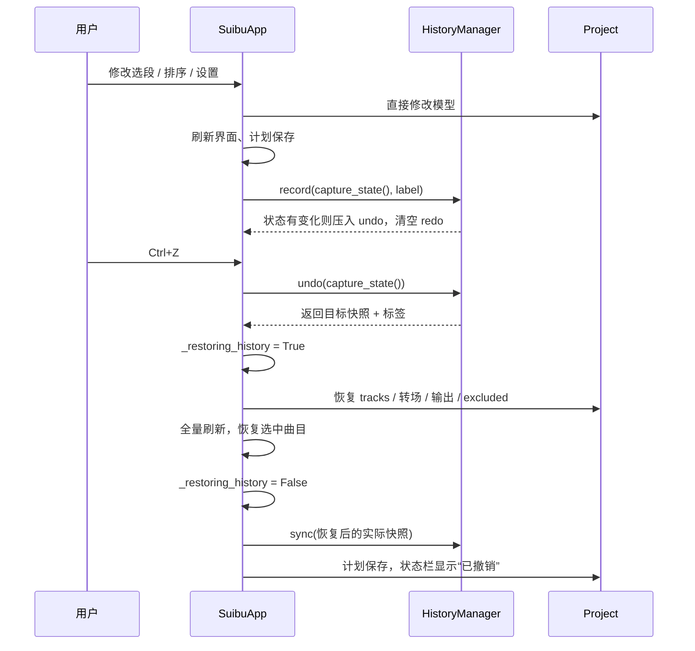

记录点：

- 波形拖动释放、时间输入、快速选区；
- 启用 / 停用、设为整首、移除、添加；
- 拖拽排序、上移 / 下移、排序按钮；
- 选择转场、转场复选框、时长 / 淡化、音量释放；
- 导出格式、码率、文件名、统一响度。

不记录：

- 异步探测得到的时长 / 编码 / 采样率 / 转场源时长；
- 当前选中行、缩放视口、试听起点、波形缓存；
- 窗口尺寸、滚动位置。

### 7.9 自动保存

- 任何模型修改后调用 `_schedule_save()`。
- 650ms 去抖：连续拖动波形不会每一步都写磁盘。
- 保存成功后 `dirty=False`。
- 关闭窗口、打开新文件夹、开始导出前强制保存。
- 保存失败只在状态栏显示，不弹模态框，避免打断编辑；用户可以继续重试。
- 保存实现及回退策略见 4.8。

### 7.10 关闭流程

1. 若正在导出：询问用户；确认后设置取消事件；
2. `_closing=True`，阻止事件轮询继续调度；
3. 停止试听；
4. 保存工程与用户设置；
5. 取消 `after` 定时器；
6. 清理临时 WAV 目录；
7. `destroy()`。

后台线程是 daemon；进程退出时由操作系统回收。导出线程在正常退出路径会先收到取消信号；异常退出可能留下半成品，但下次导出会使用新的唯一文件名，不会覆盖已有文件。

---

## 8. 错误处理与可靠性

### 8.1 异常类型

| 类型 | 模块 | 含义 | 处理方式 |
| --- | --- | --- | --- |
| `AudioError` | `audio.py` | 用户可理解的音频处理错误 | 转为对话框或状态栏 |
| `AudioCancelled` | `audio.py` | 用户取消导出 | 不作为错误，显示“已取消导出” |
| `ProjectError` | `project.py` | 项目目录或保存失败 | 对话框 / 状态栏 |
| `OSError` | Python | 文件系统、权限、路径错误 | 捕获并转为用户提示 |
| `ValueError` | Python | 时间格式、JSON 结构等 | 输入框回退 / 重建项目 |
| 其他 `Exception` | 任意 | 未预期错误 | `report_callback_exception` 打印堆栈并弹窗 |

### 8.2 错误矩阵

| 场景 | 检测点 | 用户看到 | 数据影响 / 恢复 |
| --- | --- | --- | --- |
| FFmpeg 缺失 | `ffmpeg_path()` | 错误对话框或状态栏：检查 `bin\ffmpeg.exe` | 无法处理音频，修复后重启 |
| 歌曲文件丢失 | `Track.is_missing` | 行红色；导出前阻止 | 源文件不被删除，需恢复或移除 |
| 音频无法读取 | `probe_audio()` | 行橙色；右键“重新读取音频” | 不参与导出（duration=0），可重试 |
| 波形读取失败 | `load_waveform()` | 波形区“无法读取波形” | 仍可手动输入时间（若时长已知） |
| 试听渲染失败 | `render_preview()` | 状态栏“试听准备失败” | 不影响工程和导出 |
| 无音频输出设备 | `winsound.PlaySound` | 状态栏“试听失败” | 导出不受影响 |
| 转场文件损坏 / 不可读 | `transition_probe_error` | 清除路径 + 错误对话框 | 需重新选择转场 |
| 转场文件缺失 | 打开面板 / 导出前 | 红色提示 / 阻止导出 | 重新选择 |
| 工程 JSON 损坏 | `Project._from_file()` | 警告后重建项目 | **会随后保存并覆盖损坏文件**，需提前备份 |
| 工程保存失败 | `Project.save()` | 状态栏“保存失败” | 保留内存数据，可重试；不弹框 |
| 输出目录不可写 | FFmpeg 退出非 0 | 导出失败对话框 | 不生成有效文件 |
| 磁盘空间不足 | FFmpeg 错误 | 取 stderr 最后一行的错误 | 无有效文件 |
| 输出文件被占用 | FFmpeg 退出非 0 | 导出失败 | 换文件名 / 关闭占用程序 |
| 导出中关闭 | `_on_close` | 询问“当前导出将被取消” | 取消并删除未完成文件 |
| UI 回调异常 | `report_callback_exception` | 程序错误对话框 + 堆栈到控制台 | 用户可继续或重启 |
| 重复打开文件夹 | `_export_running` | 提示等待或取消 | 不改变当前项目 |

### 8.3 数据安全设计

- **不删除源音频**：移除操作只修改项目；确认框明确提示。
- **不覆盖成品**：导出前使用唯一路径，同名文件追加 `(2)` 等。
- **临时文件清理**：
  - 试听 WAV 在退出时删除整个临时目录；
  - 导出滤镜脚本在 `finally` 中删除；
  - 取消时删除未完成的输出。
- **保存回退**：原子替换失败时直接写目标文件，并清理临时文件。
- **默认值防御**：JSON 缺字段使用默认值；曲目时间被 `normalise()` 夹紧。
- **状态一致性**：`current_track` 必须属于当前项目；导出前重新校验所有选中曲目和转场。

### 8.4 已知可靠性风险

| 风险 | 说明 | 建议 |
| --- | --- | --- |
| 损坏工程被覆盖 | 重建后自动保存会覆盖原文件 | 重要工程先备份，后续可加入自动 `.bak` |
| 自动保存无历史版本 | 没有撤销 / 多版本 | 复制项目 JSON 做节点备份 |
| 导出进程被强杀 | 可能残留部分文件 | 手动删除输出目录中的半成品 |
| 长歌单句柄压力 | 单次滤镜打开所有输入 | 分批制作；后续可分段导出 |
| 网络盘 / 移动硬盘中断 | 读取或保存失败 | 尽量使用本地磁盘 |
| 文件同名不同内容 | 缓存键包含 mtime/size | 修改后时间戳变化即可失效 |

---

## 9. 安全、隐私与许可

### 9.1 数据与网络

- 程序不包含网络请求、账号、云同步或遥测。
- 所有音频、工程和输出都在本地文件夹。
- 用户设置仅保存最后项目路径（`%APPDATA%\SuiWuMixer\settings.json`）。
- 不需要管理员权限，不写系统目录，不注册服务 / 文件关联。

### 9.2 命令与路径安全

- **命令注入防护**：所有 FFmpeg 调用使用参数数组，不经过 shell；文件路径不会拼进滤镜表达式。
- **滤镜脚本**：只包含数字、固定滤镜名和输入索引；路径通过 `-i` 参数传递。
- **目录逃逸防护**：输出文件名取 `Path(name).name`，丢弃 `../` 等目录部分。
- **工程反序列化**：只解析 JSON 数据，不执行代码；非法值被默认值 / 范围校验吸收。
- **外部路径**：项目允许绝对路径，意味着工程文件可能暴露本机路径；分享工程前应检查。
- **符号链接 / junction**：路径经过 `resolve()`；指向项目外的文件按外部路径保存。

### 9.3 可执行文件与 SmartScreen

便携包中的 `随舞剪辑台.exe` 是未签名的本地编译启动器，可能触发 Windows SmartScreen 或安全软件询问。处理方式：

1. “更多信息 → 仍要运行”；
2. 或直接运行 `启动随舞剪辑台.cmd`，使用随附的 `runtime\pythonw.exe`。

发行方如需正式分发，应购买代码签名证书签署启动器，并对便携包做 SHA-256 校验。

### 9.4 许可

| 组件 | 许可 | 位置 |
| --- | --- | --- |
| 随舞剪辑台源代码 | MIT | `LICENSE` |
| Python 运行时 | PSF License 2.0 | `runtime/LICENSE.txt` |
| FFmpeg | LGPL-3.0-or-later | `licenses/LGPL-3.0.txt`、`licenses/GPL-3.0.txt` |
| Tcl/Tk | BSD 风格 | Python / Tcl-Tk 分发许可 |
| .NET 启动器 | MIT（本项目源码） | 使用系统 .NET Framework，不重分发 |

FFmpeg 为独立可执行文件，通过命令行调用。发布时保留 `THIRD_PARTY_NOTICES.md`、许可全文和 FFmpeg 版本 / 构建配置说明。

---

## 10. 测试设计

### 10.1 测试环境

| 项 | 值 |
| --- | --- |
| 系统 | Windows 11（Build 26100）64 位 |
| Python | 3.13.3 |
| FFmpeg | `n4.3.2-160-gfbb9368226` |
| 测试框架 | 标准库 `unittest` |
| 测试目录 | `tests/` |
| 测试数据 | 运行时用 FFmpeg `lavfi sine` 生成的临时 MP3 |

### 10.2 自动化测试

执行命令（PowerShell）：

```powershell
$env:PYTHONPATH = (Get-Location)
py -3.13 -m unittest discover -s tests -v
```

当前共 18 个测试，全部通过：

| 用例 | 覆盖点 | 断言重点 |
| --- | --- | --- |
| `test_parse_time_formats` | 时间输入 | 秒、冒号、分钟秒、中文单位、非法输入 |
| `test_format_duration` | 时间显示 | 秒级、毫秒级、超过 1 小时 |
| `test_natural_sort` | 自然排序 | `1/2/10` 顺序 |
| `test_probe_and_waveform` | 探测 + 波形 | 时长、采样率、峰值数量与非零 |
| `test_export_with_transitions` | 带转场导出 | 计划时长、边界数、WAV 实际时长、48k 立体声 |
| `test_export_without_transition` | 无转场导出 | 单段 FLAC，实际时长 1 秒 |
| `test_export_cancelled_removes_partial_file` | 取消导出 | 抛 `AudioCancelled`，不保留半成品 |
| `test_export_with_loudness_normalization` | 统一响度导出 | 滤镜含 `loudnorm`，输出 48k 立体声 |
| `test_output_normalize_persists` | 响度设置持久化 | 重新加载工程后 `normalize=True` |
| `test_scan_natural_order` | 文件夹扫描 | 自然文件名顺序 |
| `test_remove_is_persistent` | 移除持久化 | 重新打开不自动加回，excluded 非空 |
| `test_manual_reorder_persists` | 手排持久化 | 重新加载顺序正确 |
| `test_sort_by_duration` | 排序 | 2/5/9 秒升序 |
| `test_transition_boundaries_include_end_only` | 边界计算 | 仅片尾转场时边界数为 1 |
| `test_record_undo_redo` | 历史栈 | undo / redo 状态与标签 |
| `test_noop_not_recorded` | 历史去重 | 相同状态不入栈 |
| `test_new_action_clears_redo` | 历史分支 | 新编辑清空 redo |
| `test_limit` | 历史上限 | 只保留最近 N 步 |

测试隔离：

- 临时目录位于项目内 `.testtmp/`，使用 UUID 命名；
- 每个测试用 `setUp/tearDown` 清理；
- 无第三方 fixture 或网络依赖；
- 若找不到 FFmpeg，音频集成测试自动跳过。

### 10.3 已执行的手工验证

| 编号 | 场景 | 结果 |
| --- | --- | --- |
| M-01 | 打开含 4 首歌的文件夹 | 4 首按名称加载，首个自动选中 |
| M-02 | 波形拖动入点 / 出点 | 绿色 / 橙色把手、数字与时序同步 |
| M-03 | 输入 `01:23.500` | 时间与波形同步 |
| M-04 | 试听选段 | 有输出，停止有效，游标移动 |
| M-05 | 选择转场并探测 | 源时长显示，转场从曲目列表移除 |
| M-06 | 导出 MP3 | 可播放，进度完成 |
| M-07 | 导出 WAV / FLAC / M4A | 均可被 FFmpeg 读取，采样率 48k、立体声 |
| M-08 | 同名文件重复导出 | 自动生成 `(2)` |
| M-09 | 导出取消事件（引擎层） | 抛取消异常，未完成文件被删除 |
| M-10 | 关闭后重开同一文件夹 | 顺序、选段、转场恢复 |
| M-11 | 从项目移除后重开 | 不被自动加回 |
| M-12 | 最小窗口 1160×760 | 卡片不重叠，控件可用 |
| M-13 | 便携包解压启动 | 无安装即可打开界面 |
| M-14 | 撤销 / 重做选段与排序 | 状态恢复，按钮 / Tooltip 更新 |
| M-15 | Ctrl+滚轮缩放、滚轮平移、滚动条 | 视口变化，选段不变 |
| M-16 | Shift+点击 / 标尺设置试听起点 | 起点标记出现，从该点播放 |
| M-17 | 统一响度勾选导出 | 滤镜生效，工程保存状态 |

### 10.4 手工测试清单（发布前）

**项目与歌单**

- [ ] 空文件夹打开提示正确；
- [ ] 含 1 首 / 100 首歌曲时可滚动；
- [ ] 文件名含中文、空格、括号、数字前缀；
- [ ] 重名歌曲（不同目录）可区分；
- [ ] 添加项目外文件，重开仍存在；
- [ ] 删除 / 改名歌曲后行显示缺失；
- [ ] F5 重新扫描只追加新歌，不恢复已移除歌曲。

**选段**

- [ ] 拖入点、拖出点、整体平移；
- [ ] 点击选区左右空白；
- [ ] 输入 0、超长、负数、空值、非法文本；
- [ ] 极短歌曲（<1 秒）；
- [ ] 30/60/90 秒在短歌上自动夹紧；
- [ ] 整首按钮；
- [ ] 试听中切换曲目 / 改时间 / 停止；
- [ ] 缩放：按钮、Ctrl+滚轮、滚轮平移、滚动条、中键拖动；
- [ ] 自定义试听起点：标尺点击、Shift+点击、右键菜单；
- [ ] 撤销 / 重做各类编辑，撤销后再编辑会清空重做。

**转场**

- [ ] 不选转场；
- [ ] 仅曲目之间；
- [ ] 仅片尾；
- [ ] 完整播放；
- [ ] 转场短于设定长度；
- [ ] 音量 0% / 100% / 150%；
- [ ] 淡化为 0 / 很长；
- [ ] 转场文件缺失后重新选择；
- [ ] 转场文件同时放在歌单文件夹。

**导出**

- [ ] 4 种格式；
- [ ] 单曲、多曲、全部停用；
- [ ] 输出目录不存在时自动创建；
- [ ] 文件名包含非法字符 / 路径；
- [ ] 同名文件；
- [ ] 导出中取消、关闭程序；
- [ ] 磁盘空间不足（可模拟小盘）；
- [ ] 文件被其他程序占用；
- [ ] 勾选 / 取消统一响度，确认导出成功且工程保存该状态。

**UI / 打包**

- [ ] 100% / 125% / 150% 缩放；
- [ ] 最小尺寸；
- [ ] 深色标题栏；
- [ ] 无控制台启动器；
- [ ] `.cmd` 兜底；
- [ ] 干净解压目录启动；
- [ ] 任务栏图标与窗口图标。

### 10.5 验收矩阵

| 需求 | 自动化 | 手工 |
| --- | --- | --- |
| 项目打开 / 恢复 | 部分 | M-01、M-10 |
| 歌单排序 / 移除 | 是 | M-11 |
| 波形选段 / 时间输入 | 部分 | M-02、M-03 |
| 试听 | 否 | M-04 |
| 转场 | 边界自动测试 | M-05、M-06 |
| 导出四格式 | 部分（WAV/FLAC） | M-06、M-07 |
| 取消 / 重名 | 否 | M-08、M-09 |
| 便携启动 | 否 | M-13 |

### 10.6 未覆盖 / 建议补充

- 图形界面自动化（当前没有 UI 测试框架）；
- 取消按钮的端到端 UI 状态（引擎层取消已自动化，按钮交互待补 UI 测试）；
- 不同声卡 / 蓝牙设备下的 `winsound` 行为；
- 特殊编码（VBR MP3、APE、WMA）和损坏文件；
- 超长歌单（>100 首）和长文件（>2 小时）的压力测试；
- Unicode 路径 / 网络盘 / 只读目录；
- 并发打开多个应用实例；
- 导出过程中断电 / 强杀后的残留。

建议后续引入：

1. `pytest` + `pytest-qt` 或 Tk 驱动做 UI 冒烟；
2. golden audio 对比（固定输入、固定滤镜、哈希/包络比较）；
3. 属性测试（时间夹紧、边界计算）；
4. CI（Windows runner）执行单元测试和打包。

---

## 11. 构建与发布

### 11.1 源码运行

```powershell
py -3.13 app.py
```

要求：

- Python 3.10+（推荐 3.13），带 Tcl/Tk 8.6；
- 项目根 `bin/ffmpeg.exe` 存在，或 FFmpeg 在 `PATH`；
- 无 `pip install` 步骤；唯一的可选 Python 包是 `imageio-ffmpeg`，仅作为找不到二进制时的兜底。

### 11.2 图标生成

```powershell
py -3.13 tools\make_assets.py
```

生成：

- `assets/icon.png`：256×256，窗口图标；
- `assets/icon.ico`：16/24/32/48/64/128/256 多尺寸，exe 图标。

脚本只使用 `struct`、`zlib` 和标准库，不依赖 Pillow。

### 11.3 便携运行时组装

以下命令在构建机器上执行，目标是 `dist\随舞剪辑台\runtime`。

```powershell
$src = "$env:LOCALAPPDATA\Programs\Python\Python313"
$dst = "dist\随舞剪辑台\runtime"
New-Item -ItemType Directory -Force $dst | Out-Null

# 顶层运行时文件
$files = @(
  "$src\python.exe", "$src\pythonw.exe", "$src\python3.dll",
  "$src\python313.dll", "$src\vcruntime140.dll",
  "$src\vcruntime140_1.dll", "$src\LICENSE.txt"
)
Copy-Item $files $dst -Force

# 扩展模块、Tcl/Tk
robocopy "$src\DLLs" "$dst\DLLs" /E /XD __pycache__
robocopy "$src\tcl" "$dst\tcl" /E

# 标准库：排除不需要的目录和缓存
robocopy "$src\Lib" "$dst\Lib" /E `
  /XD site-packages test idlelib ensurepip pydoc_data `
      turtledemo lib2to3 venv __pycache__
```

运行验证：

```powershell
dist\随舞剪辑台\runtime\python.exe -c "import tkinter, sys; print(sys.version, tkinter.TkVersion)"
```

必须保留：

- `python313.dll`、`vcruntime*.dll`；
- `DLLs\_tkinter.pyd` 及相关 Tcl/Tk DLL；
- `tcl\tcl8.6`、`tcl\tk8.6`；
- `Lib\tkinter`。

### 11.4 复制应用文件

```text
dist/随舞剪辑台/
├─ app.py
├─ svdj/
├─ assets/
├─ bin/ffmpeg.exe
├─ docs/
├─ licenses/
├─ runtime/
├─ README.md
├─ LICENSE
├─ THIRD_PARTY_NOTICES.md
├─ 启动随舞剪辑台.cmd
└─ 随舞剪辑台.exe
```

不要复制：

- `.testdata/`、`.testtmp/`、`.tmp/`；
- `__pycache__/`、`*.pyc`；
- `demo_project/`；
- 用户自己的歌单 / 测试输出。

### 11.5 编译启动器

启动器是 40 KB 的 .NET Framework WinExe：

```powershell
$csc = "$env:WINDIR\Microsoft.NET\Framework64\v4.0.30319\csc.exe"
& $csc /nologo /target:winexe /platform:anycpu /optimize+ /codepage:65001 `
  "/win32icon:$PWD\assets\icon.ico" `
  "/out:$PWD\dist\随舞剪辑台\随舞剪辑台.exe" `
  .\tools\launcher.cs
```

启动器逻辑：

1. `AppDomain.CurrentDomain.BaseDirectory` 定位应用根；
2. 检查 `runtime\pythonw.exe` 与 `app.py`；
3. 使用 Windows 参数引用规则拼接 `app.py` 和透传参数；
4. 设置 `WorkingDirectory`、`CreateNoWindow`、`PYTHONUTF8=1`；
5. `Process.Start()`；失败用 `MessageBoxW` 显示错误。

### 11.6 打包与校验

```powershell
$zip = "dist\随舞剪辑台_v1.1.0_便携版.zip"
Compress-Archive -Path "dist\随舞剪辑台" -DestinationPath $zip -CompressionLevel Optimal
Get-FileHash $zip -Algorithm SHA256
```

发布目录中的 `SHA256SUMS.txt` 记录 zip 的 SHA-256。压缩包约 35 MB，解压后约 90 MB。

### 11.7 版本与发布记录

- 软件版本：`svdj/__init__.py` 的 `__version__`（当前 `1.1.0`）；
- 工程格式版本：`PROJECT_VERSION = 1`；
- 发布包名建议：`随舞剪辑台_v<版本>_便携版.zip`；
- 发布说明应包含：新增功能、修复、已知问题、FFmpeg / Python 版本、SHA-256。

### 11.8 发布检查清单

- [ ] `py -3.13 -m compileall` 无语法错误；
- [ ] 18 个自动化测试全部通过；
- [ ] 手动验证 MP3/WAV/FLAC/M4A；
- [ ] 从干净解压目录启动便携包；
- [ ] 检查 `runtime` / `bin` / `assets` 完整；
- [ ] 检查 `README`、许可、第三方声明；
- [ ] 重新生成 SHA-256；
- [ ] 在 100% 与 125% DPI 下查看界面；
- [ ] 确认 zip 中没有测试文件、缓存和个人路径。

### 11.9 持续集成建议

当前发布为本地手工构建。建议的 Windows CI 流程：

```text
checkout
  → 安装 Python 3.13 x64（含 Tk）
  → 准备 bin/ffmpeg.exe（缓存或 artifact）
  → py -3.13 -m compileall
  → py -3.13 -m unittest discover -s tests
  → 组装 runtime
  → 编译 launcher
  → 生成 zip + SHA-256
  → 上传 artifact
```

运行 GUI 冒烟测试需要可交互桌面；CI 中可只做导入、模型和音频引擎测试。

---

## 12. 部署与运维

### 12.1 用户部署

1. 解压 `随舞剪辑台_v1.1.0_便携版.zip`；
2. 保持 `随舞剪辑台.exe`、`app.py`、`runtime/`、`bin/`、`assets/` 的相对位置；
3. 双击 `随舞剪辑台.exe`；
4. 如被拦截，双击 `启动随舞剪辑台.cmd`；
5. 首次启动后选择一个歌单文件夹。

不需要管理员权限；不要只复制 exe 到其他目录，否则找不到 `runtime` 和 `bin`。

### 12.2 用户数据位置

| 数据 | 位置 | 是否随包 |
| --- | --- | --- |
| 工程 | `<歌单文件夹>/随舞项目.json` | 否，用户项目 |
| 成品 | `<歌单文件夹>/输出/` | 否 |
| 最后项目 | `%APPDATA%\SuiWuMixer\settings.json` | 否，每用户 |
| 试听临时文件 | `%TEMP%\suibu_preview_<pid>/` | 否，退出清理 |
| 导出临时滤镜 | `<输出目录>/.suibu_filters_<pid>_<uuid>.txt` | 否，导出结束清理 |

### 12.3 更新

覆盖以下内容即可保留用户项目：

- `app.py`、`svdj/`、`assets/`、`docs/`；
- `随舞剪辑台.exe`；
- `runtime/`、`bin/ffmpeg.exe`（如有升级）。

不要覆盖：

- 用户的歌单文件夹；
- 用户的 `随舞项目.json`；
- 用户的 `输出/`。

工程格式版本升级时，应先备份并在 `Project._from_file()` 中实现迁移。

### 12.4 备份与恢复

- 备份整个歌单文件夹（含 `随舞项目.json`）即可保留项目。
- 工程只记录路径；外部歌曲需要单独备份。
- 损坏工程可删除 / 改名后重新扫描，但原选段丢失。
- 建议活动前复制一份工程 JSON 并加日期。

### 12.5 卸载

便携版没有安装器：

1. 删除解压后的程序文件夹；
2. 如需清除最后项目记忆，删除 `%APPDATA%\SuiWuMixer`；
3. 用户歌单和输出目录不会被删除，需要用户自行处理。

### 12.6 运维排障

| 现象 | 排查 |
| --- | --- |
| 双击无反应 | 检查 exe 与 `runtime`、`bin`、`app.py` 相对位置；用 `.cmd` 兜底 |
| SmartScreen 拦截 | 更多信息 → 仍要运行；或使用 cmd |
| 找不到 FFmpeg | 检查 `bin\ffmpeg.exe`；源码运行可加入 PATH |
| 界面能开但没声 | 检查系统默认音频设备；导出不依赖声卡 |
| 工程读不出来 | 备份原 JSON；删除后重扫；查看警告和状态栏 |
| 导出失败 | 检查输出目录权限、磁盘空间、文件占用和源文件是否存在 |
| 界面缩放异常 | 当前为系统 DPI 感知（非 Per-Monitor V2）；尝试 100% / 125% |
| 后台残留 pythonw | 关闭窗口后仍异常时任务管理器结束；检查是否导出中强退 |

### 12.7 日志与诊断

当前版本没有持久化日志：

- FFmpeg 错误通过 `stderr` 最后一行呈现；
- Python 未处理异常通过 `tkinter` 回调打印到启动控制台并弹窗；
- `pythonw` 启动时没有控制台，因此堆栈不会落盘。

生产部署建议后续增加：

- `%APPDATA%\SuiWuMixer\logs\app.log` 滚动日志；
- 导出任务 ID 和 FFmpeg 完整命令记录（脱敏路径可选）；
- “导出诊断包”功能。

---

## 13. 二次开发指南

### 13.1 编码约定

- Python 3.10+ 语法；全部模块 `from __future__ import annotations`。
- 数据类用于模型和音频规格；UI 状态保存在 `SuibuApp` 实例。
- 公开函数写 docstring；用户可见错误使用中文。
- 不引入第三方 Python 运行时依赖，除非同时更新便携运行时和文档。
- 新 UI 文本保持中文；颜色 / 字体统一走 `theme.py`。
- 新增后台任务必须通过 `events` 队列回主线程。
- 模型层不导入 `tkinter`。
- 时间统一用秒（float），UI 显示时格式化，保存保留 3 位小数。

### 13.2 增加输入格式

1. 在 `AUDIO_EXTENSIONS` 加入扩展名（`svdj/audio.py`）；
2. 确认随包 FFmpeg 支持该解码器；
3. 检查文件选择器的 patterns（由扩展名集合自动生成）；
4. 添加一个真实文件测试 `probe_audio` / `load_waveform` / 导出；
5. 更新 README 和本文档。

### 13.3 增加输出格式

需要同时修改：

| 位置 | 修改 |
| --- | --- |
| `svdj/audio.py` | `FORMAT_LABELS`、`build_export_plan()` 的格式校验 |
| `svdj/audio.py` | `export_command()` 增加编码参数 |
| `svdj/ui.py` | `FORMAT_CHOICES`、`FORMAT_LABELS`、扩展名逻辑 |
| `svdj/project.py` | `_from_file()` 格式白名单、`output_path()` |
| 测试 | 实际导出并探测时长/编码/采样率 |
| 文档 | README、格式表、限制 |

注意：`output_path()` 和 `_commit_filename()` 只负责扩展名，不负责编码；编码必须与扩展名一致。

### 13.4 扩展统一响度

v1.1 已实现单遍 `loudnorm`（`Project.output.normalize` + 输出面板复选框 + `build_export_plan(normalize=True)`）。若要提高质量：

1. 增加目标 LUFS / TP / LRA 设置，而不是固定 `-14/-1.5/11`；
2. 第一遍用 `loudnorm=...:print_format=json` 测量，第二遍用测量结果做线性归一化；
3. 两遍会显著增加导出时间，需要进度和取消适配；
4. 也可以在导入时为每首歌写响度偏移，保持整段混音的动态关系。

### 13.5 增加交叉淡化

当前是“插入独立转场”，不是“歌曲重叠交叉淡化”。若需要：

- 用 `acrossfade=d=<秒>:c1=tri:c2=tri` 替代 `concat`；
- 需要知道相邻片段的实际结束时间；
- 成片总时长会减少交叉长度；
- 转场音频的插入语义要重新设计（独立音效 vs 交叉淡化）；
- 不能简单把所有输入一次性 `concat`，要构造链式滤镜。

建议作为新功能分支，不直接改现有导出语义。

### 13.6 增加智能选段

当前版本没有自动选段。实现思路：

1. 使用 `Waveform.peaks` 计算滑动窗口能量；
2. 目标时长 `L`，窗口步长约 0.5–1 秒；
3. 评分可用平均峰值、峰值方差、首尾能量差；
4. 寻找最高分窗口，向两侧扩展到目标长度；
5. 避免窗口跨越长时间静音；
6. 将结果写入 `Track.start/end`，并在 UI 中标记为“建议”；
7. 批量应用时逐个后台处理，不可在 UI 线程计算。

注意：峰值包络不等于节拍 / 高潮检测；要做高质量自动选段，需要引入节拍 / 结构分析。

### 13.7 增加逐边界转场

需要：

- 在 `Track` 或边界模型增加 `use_transition: bool`；
- JSON 新增字段并做默认兼容；
- `build_export_plan()` 的边界数量、`concat_parts` 和 `asplit` 标签随之变化；
- UI 在歌曲行或边界处提供开关；
- 测试边界组合（N 首、任意开关）。

### 13.8 扩展撤销 / 重做

v1.1 使用 `svdj/history.py` 的快照栈，覆盖模型编辑，不覆盖视图状态。若要进一步扩展：

- 改为 `Command` 接口（do/undo）可减少大歌单的快照内存；
- 把缩放视口、试听起点、选中行纳入历史（需要区分模型历史和视图历史）；
- 为历史增加“历史面板”和按动作合并（连续音量调整合并为一步）；
- 自动保存仍应在历史恢复后触发。

### 13.9 本地化

当前文本硬编码在 `ui.py`、`widgets.py`、`audio.py` 和启动器。若需多语言：

1. 建立 `i18n.py` 字典或 gettext；
2. 将用户可见字符串替换为 key；
3. 在设置中保存语言；
4. 字体回退需要覆盖目标语言。

### 13.10 扩展波形缩放 / 滚动

v1.1 已在 `WaveformView` 内实现 `view_start/view_end`、缩放、滚轮平移、中键拖动和滚动条。进一步扩展：

- 按当前视口异步重新请求更高分辨率的波形桶（目前 UI 一次请求 4000 桶）；
- 增加频谱 / RMS 视图；
- 增加时间网格吸附、节拍线；
- 记住每首歌的缩放视口（目前切换曲目会回到全览）。

### 13.11 推荐开发顺序

1. 修复 / 补充测试；
2. 工程备份与恢复；
3. 智能选段（作为建议，不自动覆盖）；
4. 逐边界转场；
5. 两遍 loudnorm / 逐首响度工具；
6. 波形视口二次采样 / 频谱；
7. 完整衔接试听；
8. 交叉淡化 / 多轨时间线（大版本）。

---

## 14. 已知限制与路线图

### 14.1 当前限制

| 类别 | 限制 | 影响 |
| --- | --- | --- |
| 平台 | 仅正式支持 Windows 10/11 64 位 | 其他系统无 `winsound` / Explorer 集成 |
| 扫描 | 只扫描项目文件夹顶层 | 子目录歌曲需手动添加 |
| 自动选段 | **没有**自动节拍 / 高潮检测 | 用户仍需逐首选择 |
| 自动拼接 | 有；选段与转场自动拼接 | 名称中的“自动”指拼接流程 |
| 转场 | 只支持独立插入，不支持交叉淡化 | 不能做重叠过渡 |
| 转场范围 | 全局一份转场 | 不能为不同歌曲设不同音效 |
| 时长 | 转场最长 30 秒（完整播放除外） | 长转场需勾选完整播放 |
| 音频 | 统一响度为单遍 `loudnorm`；无逐首处理 / EQ / 降噪 | 极端动态素材可能有轻微抽吸 |
| 波形 | 支持缩放 / 滚动，但无频谱；峰值桶分辨率有限 | 极限放大时细节呈块状 |
| 撤销 | 快照只覆盖模型，不覆盖缩放 / 试听点 / 窗口状态；上限 100 步 | 视图操作不可撤销 |
| 预览 | 可自选起点试听单段，但不能预览完整成片衔接 | 导出前无法听整体转场 |
| 工程 | 无自动备份 / 历史版本 | 损坏工程可能被覆盖 |
| 工程迁移 | 只有版本字段，无迁移代码 | 未来格式升级需补迁移 |
| 规模 | 单次滤镜打开全部输入 | 超长歌单有句柄 / 内存压力 |
| 界面 | 不支持多窗口 / 多项目并行 | 一次只能编辑一个项目 |
| 安装 | 无安装器、无代码签名、无自动更新 | SmartScreen 可能提示 |
| 日志 | 无持久化日志 | 用户侧问题难回溯 |
| 可访问性 | 波形无键盘选段；部分控件自绘 | 键盘 / 读屏支持不完整 |

### 14.2 路线图

**P0（稳定性 / 体验）**

- 损坏工程自动备份（`.bak`）；
- 导出日志与诊断信息；
- 更完整的错误提示与重试入口；
- 大批量曲目分批导出 / 进度优化。

**P1（创作能力）**

- 智能选段建议（基于能量包络）；
- 逐边界转场开关；
- 试听完整衔接（选段 + 转场）；
- 两遍 loudnorm / 手动响度目标；
- 波形视口二次采样与频谱。

**P2（专业能力）**

- 交叉淡化 / 重叠转场；
- 节拍网格 / 吸附；
- 多轨时间线 / 变速 / 变调 / EQ；
- 项目模板与批量预设；
- macOS / Linux 适配（需替换 `winsound`、Explorer、DWM）。

### 14.3 版本兼容策略

- 工程 `version` 递增时，`_from_file()` 必须支持旧版本迁移；
- 新增 JSON 字段必须提供默认值；
- 删除字段时保留兼容读取；
- 导出格式与默认设置变化应在发布说明中标注；
- 便携运行时升级需保持 `runtime` 布局或同步更新启动器。

---

## 附录 A：公开 API 参考

### A.1 `svdj.audio`

| 符号 | 类型 | 说明 |
| --- | --- | --- |
| `AudioError` | 异常 | 用户可读的音频处理错误 |
| `AudioCancelled` | 异常 | 导出被取消 |
| `LOUDNESS_TARGET` / `LOUDNESS_PEAK` / `LOUDNESS_RANGE` | 常量 | 默认 `-14 / -1.5 / 11` |
| `AudioInfo(duration, codec, sample_rate, channels)` | 冻结数据类 | 探测结果 |
| `Waveform(duration, peaks)` | 冻结数据类 | 波形；`peak_at(ratio)` |
| `ClipSpec(path, start, end, name)` | 数据类 | 导出一个选段；`duration` |
| `TransitionSpec(...)` | 数据类 | 导出转场；`clip_length` |
| `ExportPlan(...)` | 数据类 | 导出计划，含滤镜脚本和总时长 |

| 函数 | 签名要点 | 返回 / 异常 |
| --- | --- | --- |
| `app_root()` | 无 | 应用资源根目录 |
| `find_ffmpeg()` | 无 | `Path \| None` |
| `ffmpeg_path()` | 无 | `Path`，找不到抛 `AudioError` |
| `probe_audio(path)` | 文件路径 | `AudioInfo`，失败抛 `AudioError` |
| `load_waveform(path, buckets=1100, sample_rate=2500)` | `buckets >= 80` | `Waveform` |
| `format_duration(seconds, precise=False)` | 秒 | `mm:ss` / `mm:ss.mmm` |
| `format_duration_zh(seconds)` | 秒 | `N 分 SS 秒` / `N 小时 N 分 N 秒` |
| `parse_time(text)` | 时间字符串 | 秒；非法抛 `ValueError` |
| `natural_sort_key(path)` | 路径 / 名 | 可比较键 |
| `scan_audio_files(folder, recursive=False)` | 目录 | 顶层 / 递归音频 `list[Path]` |
| `render_preview(source, destination, start=None, end=None, volume=1.0)` | 源 / 目标 WAV | `Path` |
| `build_export_plan(tracks, transition, output_path, fmt='mp3', bitrate='320k', title='随舞混剪', normalize=False)` | 规格序列 | `ExportPlan` |
| `export_command(plan, filter_file)` | 计划 / 脚本 | `list[str]` |
| `run_export(plan, progress=None, cancel_event=None, filter_file=None)` | 回调 / 取消 | 输出 `Path`；`AudioCancelled` |
| `make_unique_path(path)` | 目标 | 不冲突的 `Path` |

`ExportPlan` 字段：

| 字段 | 说明 |
| --- | --- |
| `tracks` | 过滤后的 `ClipSpec` 列表 |
| `transition` | `TransitionSpec` 或 `None` |
| `output_path` | 初始目标路径；UI 可在构建后替换为唯一路径 |
| `fmt` / `bitrate` / `title` | 编码参数 |
| `filter_script` | 完整滤镜脚本 |
| `total_duration` | 预计成品秒数 |
| `transition_count` | 实际插入的转场次数 |
| `normalize` | 是否追加全局 `loudnorm` |

### A.2 `svdj.project`

| 符号 | 说明 |
| --- | --- |
| `PROJECT_FILENAME` | `随舞项目.json` |
| `OUTPUT_FOLDER` | `输出` |
| `PROJECT_VERSION` | `1` |
| `ProjectError` | 项目打开 / 保存错误 |
| `Track` | 曲目模型 |
| `TransitionSettings` | 转场设置 |
| `OutputSettings` | 输出设置 |
| `Project` | 项目聚合根 |

`Project` 方法：

| 方法 | 说明 |
| --- | --- |
| `open_folder(folder, add_new_files=True)` | 读取已有工程或新建，追加新歌，移除转场曲目 |
| `save()` | 原子写入工程 JSON；失败回退直接写入 |
| `to_dict()` | 序列化为字典 |
| `add_paths(paths)` | 添加外部 / 内部音频，去重并解除 exclusion |
| `remove_track(track)` | 从项目移除并写入 `excluded_paths` |
| `move_track(index, new_index)` | 调整顺序 |
| `sort_tracks(key, reverse=False)` | 名称 / 时长 / 选段排序 |
| `enabled_tracks()` | 启用且文件存在的曲目 |
| `transition_boundary_count()` | 实际转场边界数 |
| `total_duration()` | 预计成品秒数 |
| `ensure_output_name()` | 补默认输出文件名 |
| `output_path()` | 输出目录下的安全目标路径 |
| `update_output_extension()` | 跟随格式改扩展名 |

### A.3 `svdj.widgets`

| 类 | 关键 API |
| --- | --- |
| `Card(master, padding=18, bg=SURFACE)` | `.body` 内部容器 |
| `RoundedButton(master, text, command, style, width, height, ...)` | `.set_enabled()`、`.set_text()`、`.set_style()` |
| `WaveformView(master, on_change, on_view_change, on_audition, on_context)` | `.set_loading()`、`.set_data(..., reset_view=False)`、`.clear()`、`.set_selection()`、`.set_playhead()`、`.set_view()`、`.fit_view()`、`.zoom(factor, center_x)`、`.pan(seconds)`、`.scroll_fraction(first)`、`.set_audition()`、`.clear_audition()`、`.audition_time()`、`.redraw()` |
| `ProgressBar(master, height=7)` | `.set_progress(0..1)` |
| `Tooltip(widget, text, delay=600)` | `.update_text()` |
| `TimeEntry(master, variable, width, on_submit)` | `.entry` 内部 `tk.Entry` |

`WaveformView.on_change(start, end, final)`：

- `start` / `end`：秒；
- `final`：`False` 表示拖动中，`True` 表示释放 / 提交。

### A.4 `svdj.playback`

| 成员 | 说明 |
| --- | --- |
| `PreviewPlayer(root, on_tick, on_finished)` | 构造 |
| `is_playing` | 是否正在播放 |
| `play(wav_path, duration)` | 异步播放 WAV |
| `stop(notify=False)` | 停止；`notify=True` 且正在播时触发 `on_finished` |

### A.5 `svdj.history`

| 成员 | 说明 |
| --- | --- |
| `HistoryEntry(state, label)` | 不可变快照 + 动作名称 |
| `HistoryManager(limit=100)` | 有界撤销 / 重做管理器 |
| `.reset(state=None)` | 清空栈并设置当前基线 |
| `.sync(state)` | 更新基线但保留 undo / redo |
| `.record(state, label)` | 状态有变化则入栈；返回是否记录 |
| `.undo(current_state)` / `.redo(current_state)` | 返回 `HistoryEntry` 或 `None` |
| `.can_undo` / `.can_redo` | 是否可操作 |
| `.undo_label` / `.redo_label` | 下一个动作的标签 |

---

## 附录 B：工程 JSON Schema

以下为描述性 Schema，运行时**不会**自动校验；字段缺失使用代码默认值。

```json
{
  "$schema": "https://json-schema.org/draft/2020-12/schema",
  "title": "随舞剪辑台工程",
  "type": "object",
  "required": ["tracks"],
  "properties": {
    "app": { "type": "string" },
    "version": { "type": "integer", "minimum": 1 },
    "updated_at": { "type": "string" },
    "tracks": {
      "type": "array",
      "items": {
        "type": "object",
        "required": ["path"],
        "properties": {
          "path": { "type": "string" },
          "duration": { "type": "number", "minimum": 0 },
          "start": { "type": "number", "minimum": 0 },
          "end": { "type": "number", "minimum": 0 },
          "enabled": { "type": "boolean" },
          "codec": { "type": "string" },
          "sample_rate": { "type": "integer", "minimum": 0 },
          "channels": { "type": "integer", "minimum": 0 }
        }
      }
    },
    "excluded": {
      "type": "array",
      "items": { "type": "string" }
    },
    "transition": {
      "type": "object",
      "properties": {
        "path": { "type": "string" },
        "duration": { "type": "number", "minimum": 0 },
        "length": { "type": "number", "minimum": 0.2, "maximum": 30 },
        "full": { "type": "boolean" },
        "volume": { "type": "number", "minimum": 0, "maximum": 1.5 },
        "fade": { "type": "number", "minimum": 0, "maximum": 5 },
        "insert_between": { "type": "boolean" },
        "at_end": { "type": "boolean" }
      }
    },
    "output": {
      "type": "object",
      "properties": {
        "format": { "enum": ["mp3", "wav", "m4a", "flac"] },
        "bitrate": { "type": "string" },
        "filename": { "type": "string" },
        "normalize": { "type": "boolean" }
      }
    }
  }
}
```

---

## 附录 C：FFmpeg 命令速查

```powershell
# 1. 读取元数据（不需要完整解码）
ffmpeg -hide_banner -nostdin -i "song.mp3"

# 2. 波形：2.5kHz 单声道 s16le
ffmpeg -v error -nostdin -i "song.mp3" -map 0:a:0 -vn `
  -ac 1 -ar 2500 -f s16le pipe:1

# 3. 试听：片段转临时 WAV
ffmpeg -y -v error -nostdin -ss 12.5 -i "song.mp3" -t 30 `
  -map 0:a:0 -vn -ac 2 -ar 44100 -c:a pcm_s16le "preview.wav"

# 4. 导出：一次滤镜完成裁剪、转场、拼接
ffmpeg -y -hide_banner -loglevel error -progress pipe:1 -nostats `
  -i "a.mp3" -i "b.mp3" -i "transition.mp3" `
  -filter_complex_script "filters.txt" `
  -map "[out]" -vn -ar 48000 -ac 2 `
  -metadata "title=随舞混剪" -map_metadata -1 `
  -c:a libmp3lame -b:a 320k -id3v2_version 3 `
  "输出/随舞混剪.mp3"
```

调试时可将 `-loglevel error` 改为 `-loglevel info`，但不要在正式导出中输出大量日志。

---

## 附录 D：默认值与限制

| 项 | 默认 / 限制 |
| --- | --- |
| 窗口初始尺寸 | 屏幕宽高各减 140，最大 1340×870 |
| 窗口最小尺寸 | 1160×760 |
| 最短选段 | UI 0.15 秒；导出过滤 0.05 秒 |
| 歌曲边缘淡化 | `min(0.06, duration/4)` 秒 |
| 转场默认长度 | 2.5 秒 |
| 转场长度范围 | 0.2–30 秒（完整播放不受 30 秒限制） |
| 转场默认音量 | 85%（0–150%） |
| 转场默认淡化 | 0.18 秒（0–5 秒，且 ≤ clip/3） |
| 输出采样率 / 声道 | 48000 Hz / 2 |
| MP3 码率 | 320k / 256k / 192k |
| M4A 码率 | 320k / 256k / 192k（AAC） |
| 波形采样率 / 桶 | 2500 Hz；函数默认 1100，UI 请求 4000 |
| 波形最小可视长度 | `max(0.2, duration/200)` 秒 |
| 波形缓存 | 8 首，LRU |
| 撤销 / 重做上限 | 100 步 |
| 统一响度目标 | -14 LUFS，TP -1.5 dBTP，LRA 11 |
| 试听起点范围 | 当前选段 `[start, end]` |
| 自动保存去抖 | 650 ms |
| 事件轮询 | 50 ms |
| 试听计时 | 60 ms |
| 输出重名 | `(2)` … `(999)` |
| 支持输入 | MP3、WAV、FLAC、M4A、AAC、OGG、OPUS、WMA、AIFF、AIF、APE、ALAC |
| 支持输出 | MP3、WAV、M4A、FLAC |

---

## 附录 E：发布清单

### E.1 源码必需文件

```text
app.py
svdj/__init__.py
svdj/audio.py
svdj/project.py
svdj/history.py
svdj/ui.py
svdj/widgets.py
svdj/theme.py
svdj/playback.py
bin/ffmpeg.exe
assets/icon.png
assets/icon.ico
docs/preview.png
docs/开发文档.md
tools/launcher.cs
tools/make_assets.py
tests/test_core.py
tests/test_history.py
README.md
LICENSE
THIRD_PARTY_NOTICES.md
licenses/LGPL-3.0.txt
licenses/GPL-3.0.txt
启动随舞剪辑台.cmd
```

### E.2 便携包必需文件

```text
随舞剪辑台.exe
app.py
svdj/
assets/
bin/ffmpeg.exe
docs/
licenses/
runtime/
README.md
LICENSE
THIRD_PARTY_NOTICES.md
启动随舞剪辑台.cmd
```

### E.3 打包前检查

- [ ] 图标重新生成；
- [ ] `runtime` 目录完整且可 `import tkinter`；
- [ ] `bin/ffmpeg.exe -version` 可运行；
- [ ] 删除 `__pycache__`、`*.pyc`、测试目录；
- [ ] 编译启动器并检查图标；
- [ ] 干净解压启动一次；
- [ ] 生成 zip 和 SHA-256；
- [ ] 更新发布说明。

---

## 附录 F：验证记录

| 项 | 结果 |
| --- | --- |
| 验证日期 | 2026-10-31 |
| 系统 | Windows 11 64 位（Build 26100） |
| Python | 3.13.3 |
| FFmpeg | `n4.3.2-160-gfbb9368226` |
| 自动化测试 | 18/18 通过 |
| 导出验证 | MP3 / WAV / FLAC / M4A 均可被 FFmpeg 读取 |
| 采样率 / 声道 | 48 kHz / 立体声 |
| 便携包 | 干净解压目录可启动 |
| 界面布局 | 默认尺寸与最小尺寸均验证 |
| 工程恢复 | 顺序、选段、启用状态、转场恢复 |

发布者签字：____________________　日期：__________

---

## 附录 G：开发环境常见问题

**`ModuleNotFoundError: No module named 'svdj'`**

从项目根目录运行：

```powershell
$env:PYTHONPATH = (Get-Location)
py -3.13 app.py
```

或直接使用 `app.py`（它会把根目录加入 `sys.path`）。

**`_tkinter.TclError: no display name`**

在无桌面 / 无交互会话中运行了 GUI。测试模型和音频引擎不需要启动 Tk；UI 测试需要 Windows 交互桌面。

**找不到 FFmpeg**

检查 `bin\ffmpeg.exe`；或在源码环境执行：

```powershell
$env:PATH = "$PWD\bin;$env:PATH"
```

**保存工程权限错误**

项目文件夹可能只读或被同步软件锁定；换到本地可写目录，或检查 `随舞项目.json.tmp` 是否被占用。

**导出失败但界面正常**

用同样的输入在命令行执行 `ffmpeg`，将 `-loglevel error` 改为 `info`；检查 `stderr` 最后一行、输出目录权限和磁盘空间。

**中文路径显示异常**

终端编码可能影响日志显示；GUI 与文件 API 使用 Unicode，实际路径不受影响。构建 / 测试时建议使用 PowerShell UTF-8 或 Python 直接打印 `repr()`。

---

## 文档修订记录

| 版本 | 日期 | 说明 |
| --- | --- | --- |
| 1.0 | 2026-10-31 | 首个完整开发文档：需求、架构、数据、音频、UI、并发、测试、构建、部署、扩展与 API |
| 1.1 | 2026-10-31 | 增加撤销 / 重做、波形缩放与滚动、统一响度、自定义试听起点；同步 API、测试和发布版本 |

---

> 本文档与 `v1.1.0` 代码基线同步。修改模型字段、JSON 结构、导出语义、线程模型或发布流程时，应同步更新对应章节和附录。
